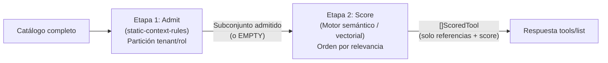

# Nota de Diseño — Extensibilidad de la Interfaz RPI (`Admit` / `Score`)

**Referencia normativa:** *Detalle de Entregables* §2.5 (Interfaz enchufable de proveedores de relevancia — RPI).

---

## 1. Propósito

La **Relevance Provider Interface (RPI)** definida en [`pkg/rpi/admit_score.go`](../pkg/rpi/admit_score.go) abstrae el **Eje 1 de control** (*qué se ofrece a un agente y en qué orden*). En V1 existen dos proveedores concretos (`admit-all` y `static-context-rules`), ambos enfocados en la etapa de admisión por tenant y rol (`Capabilities{Admit: true, Score: false}`).

Esta nota documenta cómo un futuro motor de puntuación semántica (por ejemplo, basado en embeddings y búsqueda vectorial) encaja limpiamente en la etapa **`Score`** **sin modificar la interfaz `RPIProvider`**, ni tocar código en `molu` ni en el Hub.

---

## 2. Contrato de dos etapas y declaración de capacidades

```go
type Capabilities struct {
    Admit bool `json:"admit"`
    Score bool `json:"score"`
}

type RPIProvider interface {
    Capabilities() Capabilities
    Admit(ctx context.Context, actx AdmitContext, candidates []ToolCandidate) ([]ToolCandidate, error)
    Score(ctx context.Context, actx AdmitContext, admitted []ToolCandidate) ([]ScoredTool, error)
    SetLogger(logger telemetry.Logger)
    SetMetrics(metrics telemetry.Metrics)
}
```

- **`Capabilities()`**: Permite al Hub/molu inspeccionar al arranque qué etapas implementa el proveedor registrado:
  - `admit-all` y `static-context-rules`: `{Admit: true, Score: false}` (admiten con orden estable determinista).
  - Un motor de solo-puntuación (ej. ranker semántico): `{Admit: false, Score: true}`, componible detrás de un admisor de alcance por tenant/rol.
  - Un proveedor combinado (admisión + ranking): `{Admit: true, Score: true}`.

---

## 3. Composición con un motor de puntuación semántica

El flujo de composición mantiene estrictamente separadas la **seguridad de alcance** (`Admit`) y la **relevancia semántica** (`Score`):



### Garantías no negociables (§2.5)

Todo motor conectado a `Score` cumple las siguientes invariantes, verificadas en [`pkg/rpi/score_double_test.go`](../pkg/rpi/score_double_test.go):

1. **Solo referencias, nunca segunda fuente de verdad**: `Score` recibe y devuelve `ToolCandidate` / `ScoredTool` (identificadores y contratos del catálogo), nunca copias mutables de entidades operacionales del sustrato.
2. **Índice derivado y reconstruible**: Cualquier índice vectorial mantenido por el motor se reconstruye a partir del catálogo del Hub/xolu; su pérdida no implica pérdida de datos.
3. **Partición por tenant previa a puntuar**: `Admit` filtra por `tenant` y `roles` **antes** de invocar `Score`. Un motor semántico nunca recibe ni puntúa candidatos de un tenant ajeno.
4. **Sin *padding* en resultados vacíos**: Si `admitted` está vacío, `Score` devuelve un slice vacío (`[]ScoredTool{}`), nunca rellena con herramientas irrelevantes.
5. **Indisponibilidad explícita**: Si el motor vectorial está caído o expira el timeout, `Score` devuelve un `*taxonomy.TypedError` con código `SUBSTRATE_UNAVAILABLE` (nunca una lista vacía silenciosa).
6. **Aislamiento de tipos internos**: Dimensiones de vectores, distancias coseno o IDs internos del índice jamás atraviesan `RPIProvider`; la única salida son `[]ScoredTool` con `Score` en `[0.0, 1.0]`.

---

## 4. Evidencia ejecutable (Test Double de Solo-Puntuación)

En [`pkg/rpi/score_double_test.go`](../pkg/rpi/score_double_test.go), `scoringOnlyDouble` simula un motor externo de solo-puntuación (`Capabilities{Admit: false, Score: true}`) compuesto tras `StaticContextRulesProvider`:

- `TestCapabilities_V1ProvidersAndScoreDouble`: verifica la declaración de capacidades de los proveedores V1 y del test double.
- `TestScoreOnlyDouble_Guarantees`: demuestra la composición `AdmitWithLogging` $\rightarrow$ `ScoreWithLogging`, la ausencia de fuga entre tenants aun cuando un candidato ajeno tiene mayor peso interno, la ausencia de padding en listas vacías y la emisión de `SUBSTRATE_UNAVAILABLE` ante caída del motor.
