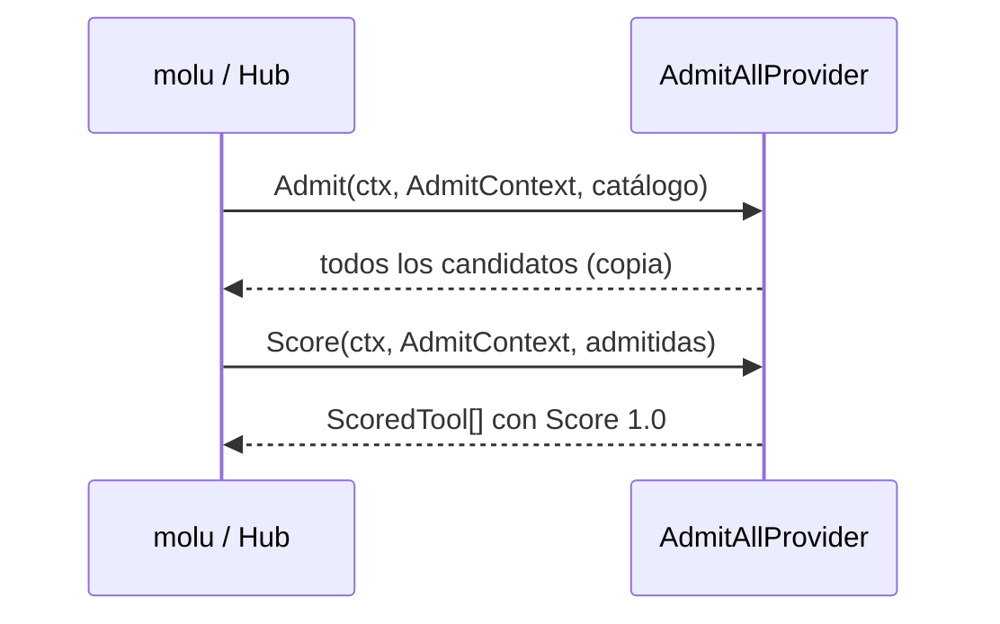

# Plan Técnico: Spec 004 — RPI Admit/Score (T-004.2 y T-004.3)

Plan derivado de `specs/004-rpi-admit-score/spec.md` (Estado: aprobada). Este plan cubre **solo** dos tarjetas de Trello:

| Tarjeta | Descripción en Trello |
| :--- | :--- |
| **T-004.2** Implementar interfaz base RPIProvider | "Crear la estructura en Go para `Admit` y `Score`. Debe ser mockeable para tests." |
| **T-004.3** Desarrollar proveedor admit-all | "Proveedor V1 de desarrollo que admita todas las herramientas (Score 1.0) incondicionalmente." |

El resto de la spec queda fuera de este plan y lo planifica el responsable de cada tarjeta: `static-context-rules` (T-004.4), `NOT_OFFERED` (T-004.5), la carga del proveedor por config (RF-1), `tools/list` (RF-2, RF-3, RF-8), el Criterio 7 y el diagrama.

---

## Archivos y Responsabilidades

| Archivo | Acción | Responsabilidad | Tarjeta |
| :--- | :--- | :--- | :--- |
| `pkg/rpi/admit_score.go` | **Modificar** | Partir de los tipos que ya existen (`ToolCandidate`, `ScoredTool`, `RPIProvider`) y alinearlos con la sección "Definiciones" de la spec: agregar `Primitive`, `Rationale` y `AdmitContext`, y cambiar `query string` por `AdmitContext` en las firmas. | T-004.2 |
| `pkg/rpi/admit_score_test.go` | **Crear** | Tests de forma del contrato: nombres JSON y embebido de `ToolCandidate` en `ScoredTool`. | T-004.2 |
| `pkg/rpi/provider_mock.go` | **Crear** | `MockRPIProvider` thread-safe, con el mismo estilo que `pkg/xolu/client_mock.go`. | T-004.2 |
| `pkg/rpi/provider_mock_test.go` | **Crear** | Tests del mock. | T-004.2 |
| `pkg/rpi/providers/admit_all.go` | **Modificar** | Adaptar el `AdmitAllProvider` existente a las firmas nuevas, conservando su constructor y su `Score` 1.0. | T-004.3 |
| `pkg/rpi/providers/admit_all_test.go` | **Crear** | Tests de `Admit`, `Score`, catálogo vacío, aislamiento y concurrencia. | T-004.3 |

**No se toca** ningún otro archivo, en particular `pkg/rpi/providers/static_context_rules.go` (T-004.4), `pkg/config`, `pkg/hub` y `cmd/`. `static_context_rules.go` sigue compilando después del cambio porque no declara que implementa la interfaz; su responsable lo adapta en T-004.4.

---

## Modelos y Contratos (T-004.2)

```go
// ToolCandidate is a catalog entry the RPI may offer to an agent.
// Primitives carry no namespace; domain functions are "namespace.Name".
type ToolCandidate struct {
	Name        string         `json:"name"`
	Description string         `json:"description"`
	InputSchema map[string]any `json:"inputSchema"`
	Primitive   bool           `json:"primitive"`
	Namespace   string         `json:"namespace"`
}

// AdmitContext identifies who is asking for tools.
type AdmitContext struct {
	Tenant string   `json:"tenant"`
	Roles  []string `json:"roles"`
	Query  string   `json:"query,omitempty"`
}

// ScoredTool is an admitted candidate with its relevance.
type ScoredTool struct {
	ToolCandidate
	Score     float64 `json:"score"`
	Rationale string  `json:"rationale,omitempty"`
}

type RPIProvider interface {
	Admit(ctx context.Context, actx AdmitContext, candidates []ToolCandidate) ([]ToolCandidate, error)
	Score(ctx context.Context, actx AdmitContext, admitted []ToolCandidate) ([]ScoredTool, error)
}
```

Los nombres JSON coinciden con la spec y con `hub.ToolRegistration`.

**Mock (`provider_mock.go`):**
- `MockRPIProvider` tiene `AdmitFunc`, `ScoreFunc`, `AdmitCalls []AdmitCall` y `ScoreCalls []ScoreCall`, todo protegido por un `sync.Mutex`.
- Si una función es `nil`, el método devuelve el error `"Admit not implemented"` o `"Score not implemented"`, igual que `MockXoluClient`.
- `Reset()` limpia las llamadas registradas.
- `var _ RPIProvider = (*MockRPIProvider)(nil)`.

---

## Proveedor admit-all (T-004.3)

- Se conserva `NewAdmitAllProvider() *AdmitAllProvider`.
- `var _ rpi.RPIProvider = (*AdmitAllProvider)(nil)`.
- **`Admit`:** devuelve todos los candidatos, en el mismo orden, en un slice nuevo. Con catálogo vacío o `nil` devuelve un slice vacío no `nil`. Ignora tenant, roles y query (RF-7).
- **`Score`:** asigna `1.0` a cada herramienta, en el orden de entrada (RF-5, RF-7).
- No tiene estado mutable, así que es seguro en uso concurrente (RF-9).
- Nunca devuelve error.

---

## Diagrama de Secuencia (Mermaid)



---

## Decisiones Técnicas y Alternativas Descartadas

- **D1. `Admit` y `Score` devuelven `error`, como en el esqueleto que ya está en el repo.** La spec los llama "métodos puros". Mantener el error permite que un proveedor futuro falle sin romper la interfaz.
  - *Descartada:* quitar el error. Rompería la interfaz con el primer proveedor que pueda fallar.
- **D2.** El parámetro de contexto de admisión se llama `actx`, para no chocar con `ctx context.Context`.
- **D3.** El mock vive en `pkg/rpi`, igual que los mocks que ya existen en `pkg/xolu` y `pkg/mcp`.
  - *Descartada:* una librería de mocks. Sería una dependencia extra para solo dos métodos.
- **D4.** admit-all devuelve un slice nuevo, para no compartir memoria con el catálogo del llamador.
- **D5.** Catálogo vacío → slice vacío no `nil`. Es la misma convención que `hub.Registry.List`.

---

## Matriz de Cobertura de Requisitos

| RF | Cubierto por | Tarjeta |
| :--- | :--- | :--- |
| Definiciones (contrato) | `TestToolCandidateJSONFields`, `TestAdmitContextJSONFields`, `TestScoredToolEmbedsCandidate` | T-004.2 |
| Mockeable (tarjeta) | `TestMockRPIProvider*` | T-004.2 |
| RF-5, RF-7 | `TestAdmitAll*` | T-004.3 |
| RF-9 | `TestMockRPIProviderConcurrent`, `TestAdmitAllConcurrent` (`-race`) | T-004.2 / T-004.3 |
| RF-10 | `grep -ri seam pkg/rpi` vacío | T-004.2 / T-004.3 |

---

## Estrategia de Tests

- `go test -v -race ./pkg/rpi/...` y la suite completa `go test -v -race ./...`.
- En Windows sin gcc, `-race` no está disponible: correr sin `-race` y verificar `-race` en Linux.
