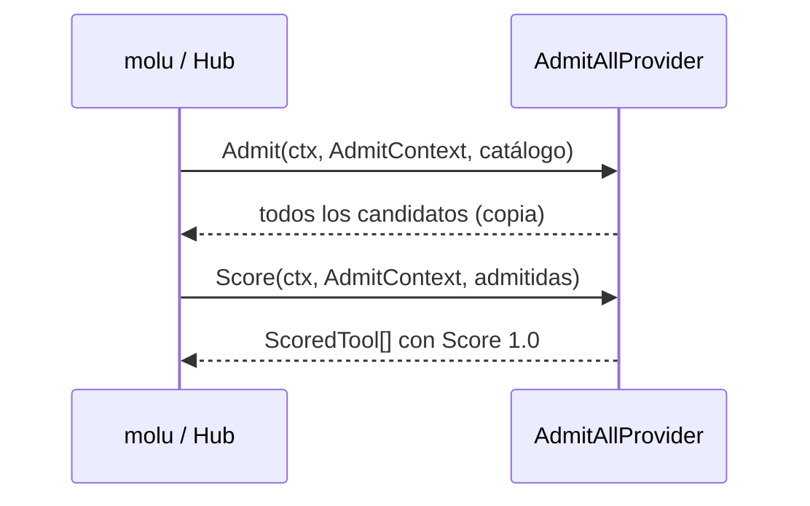

# Plan Técnico: Spec 004 — RPI Admit/Score (T-004.2 a T-004.5)

Plan derivado de `specs/004-rpi-admit-score/spec.md` (Estado: aprobada). Este plan cubre **solo** estas tarjetas de Trello:

| Tarjeta | Descripción en Trello |
| :--- | :--- |
| **T-004.2** Implementar interfaz base RPIProvider | "Crear la estructura en Go para `Admit` y `Score`. Debe ser mockeable para tests." |
| **T-004.3** Desarrollar proveedor admit-all | "Proveedor V1 de desarrollo que admita todas las herramientas (Score 1.0) incondicionalmente." |
| **T-004.4** Desarrollar proveedor static-context-rules | "Proveedor V1 que filtre herramientas leyendo roles y tenants estáticos. Incluir tests de rechazo." |
| **T-004.5** Validar código tipado NOT_OFFERED | "Test de integración: si una herramienta existe pero RPI la rechaza, el agente debe recibir estrictamente `NOT_OFFERED`." |

El resto de la spec queda fuera de este plan y lo planifica el responsable de cada tarjeta: la carga del proveedor y de las reglas por config (`MOLU_FRONT_RPI_PROVIDER`, `MOLU_FRONT_RPI_RULES_FILE`, `MOLU_FRONT_RPI_RULES_JSON`, RF-1), `tools/list` (RF-2, RF-3, RF-8), el Criterio 7 y el diagrama.

---

## Archivos y Responsabilidades

| Archivo | Acción | Responsabilidad | Tarjeta |
| :--- | :--- | :--- | :--- |
| `pkg/rpi/admit_score.go` | **Modificar** | Partir de los tipos que ya existen (`ToolCandidate`, `ScoredTool`, `RPIProvider`) y alinearlos con la sección "Definiciones" de la spec: agregar `Primitive`, `Rationale` y `AdmitContext`, y cambiar `query string` por `AdmitContext` en las firmas. | T-004.2 |
| `pkg/rpi/admit_score_test.go` | **Crear** | Tests de forma del contrato: nombres JSON y embebido de `ToolCandidate` en `ScoredTool`. | T-004.2 |
| `pkg/rpi/provider_mock.go` | **Crear** | `MockRPIProvider` thread-safe, con el mismo estilo que `pkg/xolu/client_mock.go`. | T-004.2 |
| `pkg/rpi/provider_mock_test.go` | **Crear** | Tests del mock. | T-004.2 |
| `pkg/rpi/providers/admit_all.go` | **Modificar** | Adaptar el `AdmitAllProvider` existente a las firmas nuevas, conservando su constructor y su `Score` 1.0. | T-004.3 |
| `pkg/rpi/providers/admit_all_test.go` | **Crear** | Tests de `Admit`, `Score`, catálogo vacío, aislamiento y concurrencia. | T-004.3 |

**No se toca** ningún otro archivo, en particular `pkg/rpi/providers/static_context_rules.go` (T-004.4), `pkg/config`, `pkg/hub` y `cmd/`. `static_context_rules.go` sigue compilando después del cambio porque no declara que implementa la interfaz; su responsable lo adapta en T-004.4.

---

## Modelos y Contratos (T-004.2)

```go
// ToolCandidate is a catalog entry the RPI may offer to an agent.
// Primitives carry no namespace; domain functions are "namespace.Name".
type ToolCandidate struct {
	Name        string         `json:"name"`
	Description string         `json:"description"`
	InputSchema map[string]any `json:"inputSchema"`
	Primitive   bool           `json:"primitive"`
	Namespace   string         `json:"namespace"`
}

// AdmitContext identifies who is asking for tools.
type AdmitContext struct {
	Tenant string   `json:"tenant"`
	Roles  []string `json:"roles"`
	Query  string   `json:"query,omitempty"`
}

// ScoredTool is an admitted candidate with its relevance.
type ScoredTool struct {
	ToolCandidate
	Score     float64 `json:"score"`
	Rationale string  `json:"rationale,omitempty"`
}

type RPIProvider interface {
	Admit(ctx context.Context, actx AdmitContext, candidates []ToolCandidate) ([]ToolCandidate, error)
	Score(ctx context.Context, actx AdmitContext, admitted []ToolCandidate) ([]ScoredTool, error)
}
```

Los nombres JSON coinciden con la spec y con `hub.ToolRegistration`.

**Mock (`provider_mock.go`):**
- `MockRPIProvider` tiene `AdmitFunc`, `ScoreFunc`, `AdmitCalls []AdmitCall` y `ScoreCalls []ScoreCall`, todo protegido por un `sync.Mutex`.
- Si una función es `nil`, el método devuelve el error `"Admit not implemented"` o `"Score not implemented"`, igual que `MockXoluClient`.
- `Reset()` limpia las llamadas registradas.
- `var _ RPIProvider = (*MockRPIProvider)(nil)`.

---

## Proveedor admit-all (T-004.3)

- Se conserva `NewAdmitAllProvider() *AdmitAllProvider`.
- `var _ rpi.RPIProvider = (*AdmitAllProvider)(nil)`.
- **`Admit`:** devuelve todos los candidatos, en el mismo orden, en un slice nuevo. Con catálogo vacío o `nil` devuelve un slice vacío no `nil`. Ignora tenant, roles y query (RF-7).
- **`Score`:** asigna `1.0` a cada herramienta, en el orden de entrada (RF-5, RF-7).
- No tiene estado mutable, así que es seguro en uso concurrente (RF-9).
- Nunca devuelve error.

---

## Proveedor static-context-rules (T-004.4)

| Archivo | Acción | Responsabilidad |
| :--- | :--- | :--- |
| `pkg/rpi/providers/static_context_rules.go` | **Modificar** | Adaptar el stub existente a la interfaz `RPIProvider` e implementar el filtrado por tenant y rol. |
| `pkg/rpi/providers/static_context_rules_test.go` | **Crear** | Tests de admisión, de rechazo, de `Score`, del formato de reglas y de concurrencia. |

**Formato de reglas** (spec 004, "Dudas resueltas"; spec 005 usa el mismo): JSON `map[string][]string` cuya clave es `"tenant:rol"` y cuyo valor es la lista de nombres de herramienta permitidos.

```json
{
  "acme:operator": ["walk", "find", "work_orders.CreateOrder"],
  "acme:viewer":   ["find", "get"]
}
```

- Se conserva `NewStaticContextRulesProvider(rules map[string][]string) *StaticContextRulesProvider`. El constructor copia las reglas a un índice interno (`"tenant:rol"` → conjunto de nombres), así que el proveedor no comparte memoria con quien lo crea.
- `ParseStaticContextRules(data []byte) (map[string][]string, error)` lee el JSON con `encoding/json`. Rechaza claves sin la forma `tenant:rol` (tenant o rol vacíos) y nombres de herramienta vacíos. Leer el archivo o la variable de entorno queda para RF-1.
- `var _ rpi.RPIProvider = (*StaticContextRulesProvider)(nil)`.
- **`Admit` (RF-6):** une los nombres permitidos de cada rol de `actx.Roles` para `actx.Tenant` y devuelve, en el orden del catálogo, los candidatos cuyo `Name` coincide exactamente (case-sensitive, Unicode tal cual). Sin reglas para ese tenant/rol, sin roles o con tenant vacío no admite nada (denegar por defecto). Siempre devuelve un slice no `nil`.
- **`Score` (RF-5, RF-6):** 1.0 a las herramientas permitidas para el contexto y 0.0 a las demás, ordenadas por score descendente con orden estable.
- El índice no cambia después de construir el proveedor, así que `Admit` y `Score` son seguros en uso concurrente (RF-9). `SetLogger`/`SetMetrics`/`Logger()`/`Metrics()` igual que admit-all (D6).

---

## NOT_OFFERED (T-004.5)

| Archivo | Acción | Responsabilidad |
| :--- | :--- | :--- |
| `pkg/rpi/offer.go` | **Crear** | `Offer(ctx, provider, actx, tool) error`: pasa la herramienta por `Admit`; si el proveedor la excluye devuelve `taxonomy.NewNotOffered(actx.Tenant, tool.Name)`; los errores del proveedor se devuelven sin cambios. |
| `pkg/rpi/offer_test.go` | **Crear** | Tests unitarios de `Offer` con `MockRPIProvider`. |
| `pkg/rpi_integration/not_offered_test.go` | **Crear** | Test de integración: la herramienta existe en el catálogo real (`hub.Registry`), `static-context-rules` la rechaza y el resultado es exactamente `XOLU-MOLU-FRONT-NOT_OFFERED`; con admit-all o con un rol permitido la misma herramienta sí se ofrece. |

- El test usa `hub.Registry` solo como catálogo (lectura); no modifica `pkg/hub`.
- Quién llama a `Offer` en `tools/call` (Hub o molu) lo decide la tarjeta de ensamblado del Hub, fuera de este plan.

---

## Diagrama de Secuencia (Mermaid)



---

## Decisiones Técnicas y Alternativas Descartadas

- **D1. `Admit` y `Score` devuelven `error`, como en el esqueleto que ya está en el repo.** La spec los llama "métodos puros". Mantener el error permite que un proveedor futuro falle sin romper la interfaz.
  - *Descartada:* quitar el error. Rompería la interfaz con el primer proveedor que pueda fallar.
- **D2.** El parámetro de contexto de admisión se llama `actx`, para no chocar con `ctx context.Context`.
- **D3.** El mock vive en `pkg/rpi`, igual que los mocks que ya existen en `pkg/xolu` y `pkg/mcp`.
  - *Descartada:* una librería de mocks. Sería una dependencia extra para solo dos métodos.
- **D4.** admit-all devuelve un slice nuevo, para no compartir memoria con el catálogo del llamador.
- **D5.** Catálogo vacío → slice vacío no `nil`. Es la misma convención que `hub.Registry.List`.
- **D7.** `static-context-rules` implementa `Score` (1.0 / 0.0) porque la interfaz aprobada lo exige y RF-6 lo define. El Entregables §3.6 dice que no puntúa por relevancia; con estos valores el orden entre lo admitido sigue siendo estable, que es lo que pide.
- **D8.** Claves de reglas `"tenant:rol"`, como el stub previo y la spec 005. Un tenant no puede contener `:`, porque se separa en el primer `:`.
- **D9.** `Offer` vive en `pkg/rpi` para que Hub y molu traduzcan el rechazo del RPI a `NOT_OFFERED` de la misma forma, sin depender de la tarjeta de ensamblado. La existencia de la herramienta (y un posible `NOT_FOUND`) la resuelve quien llama, con su catálogo.
- **D6. Integración con la spec 007 (telemetría).** La spec 007 agregó `SetLogger` y `SetMetrics` a `RPIProvider`, y los helpers `AdmitWithLogging`/`ScoreWithLogging`. Al unir ambas specs se conservan esos métodos, los helpers pasan a recibir `AdmitContext` (y loguean `tenant`, `roles` y `query`), y tanto admit-all como el mock implementan `SetLogger`, `SetMetrics`, `Logger()` y `Metrics()`.

---

## Matriz de Cobertura de Requisitos

| RF | Cubierto por | Tarjeta |
| :--- | :--- | :--- |
| Definiciones (contrato) | `TestToolCandidateJSONFields`, `TestAdmitContextJSONFields`, `TestScoredToolEmbedsCandidate` | T-004.2 |
| Mockeable (tarjeta) | `TestMockRPIProvider*` | T-004.2 |
| RF-5, RF-7 | `TestAdmitAll*` | T-004.3 |
| RF-6 | `TestStaticRules*` | T-004.4 |
| RF-4 (NOT_OFFERED), Criterio 2 | `TestOffer*`, `TestIntegration_NotOffered*` | T-004.5 |
| RF-9 | `TestMockRPIProviderConcurrent`, `TestAdmitAllConcurrent`, `TestStaticRulesConcurrent` (`-race`) | T-004.2 / T-004.3 / T-004.4 |
| RF-10 | `grep -ri seam pkg/rpi pkg/rpi_integration` vacío | T-004.2 a T-004.5 |

---

## Estrategia de Tests

- `go test -v -race ./pkg/rpi/...` y la suite completa `go test -v -race ./...`.
- En Windows sin gcc, `-race` no está disponible: correr sin `-race` y verificar `-race` en Linux.
