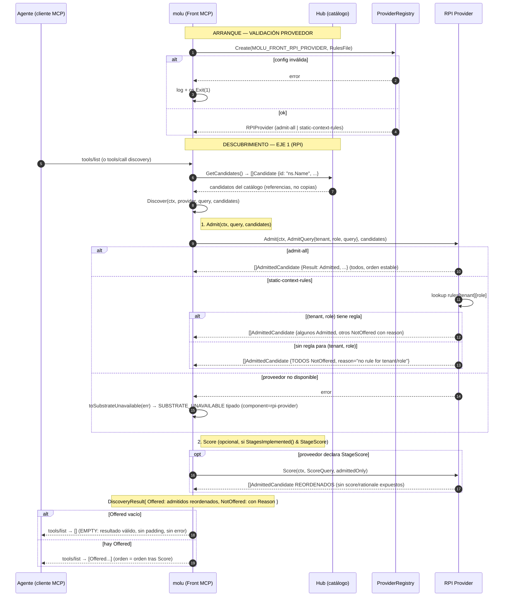

# Plan Técnico: Spec 004 — RPI Admit & Score (Eje 1: Qué se ofrece)

## Archivos y Responsabilidades

| Archivo | Responsabilidad | RF Cubiertos |
|---------|-----------------|--------------|
| `pkg/rpi/admit_score.go` | **Modificar (reemplazar)**: Interfaces `Admitter`, `Scorer`, tipos `AdmitQuery`, `ScoreQuery`, `Candidate`, `AdmittedCandidate`, `AdmissionResult`, `Stage` (bitmask), `RPIProvider` (con `StagesImplemented()`), **`DiscoveryResult`** (`Offered []Candidate`, `NotOffered []AdmittedCandidate`). Se eliminan `ToolCandidate`, `ScoredTool` y la interfaz `RPIProvider` vieja. | RF-9, RF-10, RF-13 |
| `pkg/rpi/providers/admit_all.go` | **Modificar (reemplazar)**: `AdmitAllProvider` implementa `Admitter`; admite todos los candidatos, orden estable, sin `Score`. **`NewAdmitAllProvider` devuelve `(rpi.RPIProvider, error)`**. | RF-6 |
| `pkg/rpi/providers/static_context_rules.go` | **Modificar (reemplazar)**: `StaticContextRulesProvider` implementa `Admitter`; carga reglas JSON desde archivo al arranque, filtra por `(tenant, rol)`, denegar por defecto, orden estable, sin `Score`, **sin comodines en V1**. **`NewStaticContextRulesProvider` devuelve `(rpi.RPIProvider, error)`**. | RF-7 |
| `pkg/rpi/providers/score_test_double.go` | **Crear**: `ScoreTestDouble` implementa `Scorer` (y opcional `Admitter` delegando); solo para tests, no seleccionable por config. | RF-8 |
| `pkg/rpi/providers/registry.go` | **Crear**: `ProviderRegistry` en `pkg/rpi/providers` (evita ciclo), selección por nombre, factory `NewProvider(name, config) (rpi.RPIProvider, error)`. **Valida que `StagesImplemented()` coincida con lo que el proveedor implementa** (si declara `StageScore`, debe implementar `Scorer`). | RF-5, RF-13 |
| `pkg/rpi/providers/registry_test.go` | **Crear**: Tests de registro, selección, validación de etapas, error en proveedor desconocido, validación coherencia etapas. | RF-5, RF-13 |
| `pkg/rpi/providers/admit_all_test.go` | **Modificar/Crear**: Tests unitarios `AdmitAllProvider.Admit` — admite todos, orden estable, sin filtrado. | RF-6 |
| `pkg/rpi/providers/static_context_rules_test.go` | **Modificar/Crear**: Tests unitarios `StaticContextRulesProvider` — carga reglas, filtra por tenant/rol, denegar por defecto, orden estable, `NOT_OFFERED` con razón, `EMPTY` cuando ninguno admitido. **Sin test Wildcard**. | RF-2, RF-3, RF-7 |
| `pkg/rpi/providers/score_test_double_test.go` | **Crear**: Tests unitarios `ScoreTestDouble.Score` — reordena admitidos, no puntúa candidatos de otro tenant, error controlado para `SUBSTRATE_UNAVAILABLE`. | RF-8, RF-10 |
| `pkg/rpi/discover.go` | **Crear**: `Discover(ctx, provider, query, candidates) (DiscoveryResult, error)` — orquesta: 1) `Admit`; 2) si `provider.StagesImplemented() & StageScore != 0` → `Score` **solo con admitidos**; 3) convierte error "proveedor no disponible" en `taxonomy.NewSubstrateUnavailable` con `RetryMetadata` + `Details["component"]="rpi-provider"`. Define `ErrProviderUnavailable` (error centinela con último contacto y próximo reintento). | RF-1, RF-4, RF-10, RF-13 |
| `pkg/rpi/discover_test.go` | **Crear**: Tests de orquestación — `Discover` llama Admit → Score (según `StagesImplemented`) → `DiscoveryResult` final; error proveedor → `SUBSTRATE_UNAVAILABLE` tipado con component=rpi-provider; Score reordena solo Offered. | RF-1, RF-4, RF-10, RF-13 |
| `pkg/rpi/integration_test.go` | **Crear**: Tests de integración — conformidad §2.5 (ambos proveedores), Criterio 7 (mismos inputs, providers distintos = outputs distintos), `NOT_OFFERED`, `EMPTY`, `SUBSTRATE_UNAVAILABLE` (proveedor falso). | RF-2, RF-3, RF-4, Criterio 7, §2.5 |
| `pkg/config/config.go` | **Modificar**: Añadir `MOLU_FRONT_RPI_PROVIDER` (valores `admit-all`\|`static-context-rules`, default `static-context-rules`), `MOLU_FRONT_RPI_RULES_FILE` (path). Estilo actual: `reader.str`, `validate() []error`, `errors.Join`. **Sin tags `env:` ni librerías nuevas**. Validación: proveedor conocido; si `static-context-rules` → rules file obligatorio. | RF-5, RF-7 |
| `pkg/config/config_test.go` | **Modificar**: `TestDefaults` actualizado (default `static-context-rules` requiere `MOLU_FRONT_RPI_RULES_FILE`); tests validación config RPI — proveedor inválido → error arranque, reglas requeridas para `static-context-rules`. | RF-5, RF-7 |
| `cmd/molu/main.go` | **Modificar**: Al arrancar, crea `ProviderRegistry`, llama `Create(config.RPIProvider, ProviderConfig{RulesFile: config.RPIRulesFile})`. Si error → log + `os.Exit(1)` (cumple "archivo reglas inválido → molu no arranca"). Proveedor guardado para wiring futuro con Hub (fuera de esta spec). | RF-5, RF-7 |
| `docs/diagrams/004-rpi-admit-score-sequence.mmd` | **Crear**: Diagrama Mermaid: `Admit` → si `StagesImplemented() & StageScore` → `Score` → `DiscoveryResult` con `Offered`/`NotOffered`/`EMPTY`/`SUBSTRATE_UNAVAILABLE`. **Score antes de responder al agente**. | RF-1..RF-13 |
| `docs/diagrams/004-rpi-admit-score-sequence.pdf` | **Generar local**: Renderizado con `mmdc` (repo sin CI; PDF pendiente explícito si no hay `mmdc`). | RF-1..RF-13 |

---

## Modelos y Contratos

### `pkg/rpi/admit_score.go` — Interfaces y Tipos Core (reemplaza contenido actual)

```go
package rpi

import "context"

// Stage: bitmask de etapas que implementa un proveedor
type Stage uint8

const (
    StageAdmit Stage = 1 << iota
    StageScore
)

// AdmitQuery: contexto de quién pregunta
type AdmitQuery struct {
    Tenant        string
    Role          string
    OriginalQuery string
}

// ScoreQuery: contexto de scoring (hereda de AdmitQuery)
type ScoreQuery struct {
    AdmitQuery
}

// Candidate: referencia a función de dominio del catálogo (sin schemas copiados)
type Candidate struct {
    ID          string // namespace.Nombre, ej. "work_orders.CreateOrder"
    Description string // opcional
}

// AdmissionResult: resultado de admisión por candidato
type AdmissionResult uint8

const (
    AdmissionAdmitted AdmissionResult = iota
    AdmissionNotOffered
)

// AdmittedCandidate: Candidate + su resultado de admisión
type AdmittedCandidate struct {
    Candidate
    Result AdmissionResult
    Reason string // solo si NotOffered
}

// DiscoveryResult: resultado final de Discover
type DiscoveryResult struct {
    Offered    []Candidate        // solo admitidos, en orden final (tras Score si aplica)
    NotOffered []AdmittedCandidate // los rechazados con su Reason
}

// Admitter: etapa obligatoria — filtra y marca candidatos
type Admitter interface {
    Admit(ctx context.Context, query AdmitQuery, candidates []Candidate) ([]AdmittedCandidate, error)
    // error solo para SUBSTRATE_UNAVAILABLE del proveedor
}

// Scorer: etapa opcional — reordena admitidos (sin exponer score/rationale)
type Scorer interface {
    Score(ctx context.Context, query ScoreQuery, admitted []AdmittedCandidate) ([]AdmittedCandidate, error)
}

// RPIProvider: proveedor concreto declara qué etapas implementa
type RPIProvider interface {
    Admitter // embebido: Admit es obligatorio
    // Scorer es opcional; si no lo implementa, el registry lo detecta
    StagesImplemented() Stage // bitmask: StageAdmit | StageScore
}
```

### `pkg/rpi/providers/registry.go` — Registro y Factory (nuevo archivo, evita ciclo)

```go
package providers

import (
    "fmt"

    "github.com/.../molu/pkg/rpi"
)

// ProviderConfig: configuración genérica por proveedor
type ProviderConfig struct {
    RulesFile string // para static-context-rules
}

// ProviderRegistry: registro de proveedores y factory
type ProviderRegistry struct {
    providers map[string]func(config ProviderConfig) (rpi.RPIProvider, error)
}

func NewProviderRegistry() *ProviderRegistry {
    return &ProviderRegistry{
        providers: map[string]func(config ProviderConfig) (rpi.RPIProvider, error){
            "admit-all":            NewAdmitAllProvider,
            "static-context-rules": NewStaticContextRulesProvider,
            // score-test-double NO se registra aquí (solo tests)
        },
    }
}

func (r *ProviderRegistry) Create(name string, config ProviderConfig) (rpi.RPIProvider, error) {
    factory, ok := r.providers[name]
    if !ok {
        return nil, fmt.Errorf("unknown RPI provider: %s", name)
    }
    provider, err := factory(config)
    if err != nil {
        return nil, err
    }
    // Validar coherencia: si declara StageScore, debe implementar Scorer
    if provider.StagesImplemented()&rpi.StageScore != 0 {
        if _, ok := provider.(rpi.Scorer); !ok {
            return nil, fmt.Errorf("provider %s declares StageScore but does not implement Scorer", name)
        }
    }
    return provider, nil
}

func (r *ProviderRegistry) KnownProviders() []string {
    names := make([]string, 0, len(r.providers))
    for n := range r.providers {
        names = append(names, n)
    }
    return names
}
```

### `pkg/rpi/providers/admit_all.go` — Proveedor Admit-All (reemplaza)

```go
package providers

import "github.com/.../molu/pkg/rpi"

type AdmitAllProvider struct{}

func NewAdmitAllProvider(config ProviderConfig) (rpi.RPIProvider, error) {
    return &AdmitAllProvider{}, nil
}

func (p *AdmitAllProvider) StagesImplemented() rpi.Stage {
    return rpi.StageAdmit
}

func (p *AdmitAllProvider) Admit(ctx context.Context, query rpi.AdmitQuery, candidates []rpi.Candidate) ([]rpi.AdmittedCandidate, error) {
    out := make([]rpi.AdmittedCandidate, 0, len(candidates))
    for _, c := range candidates {
        out = append(out, rpi.AdmittedCandidate{Candidate: c, Result: rpi.AdmissionAdmitted})
    }
    return out, nil
}
```

### `pkg/rpi/providers/static_context_rules.go` — Reglas Estáticas (reemplaza)

```go
package providers

import (
    "encoding/json"
    "fmt"
    "os"

    "github.com/.../molu/pkg/rpi"
)

type RulesFile struct {
    Version string      `json:"version"`
    Rules   []AllowRule `json:"rules"`
}

type AllowRule struct {
    Tenant     string   `json:"tenant"`
    Role       string   `json:"role"`
    AllowedIDs []string `json:"allowedIds"` // namespace.Nombre
}

type StaticContextRulesProvider struct {
    rules map[string]map[string][]string // tenant -> role -> allowedIDs
}

func NewStaticContextRulesProvider(config ProviderConfig) (rpi.RPIProvider, error) {
    data, err := os.ReadFile(config.RulesFile)
    if err != nil {
        return nil, fmt.Errorf("read rules file: %w", err)
    }
    var rf RulesFile
    if err := json.Unmarshal(data, &rf); err != nil {
        return nil, fmt.Errorf("parse rules file: %w", err)
    }
    p := &StaticContextRulesProvider{rules: make(map[string]map[string][]string)}
    for _, rule := range rf.Rules {
        if p.rules[rule.Tenant] == nil {
            p.rules[rule.Tenant] = make(map[string][]string)
        }
        p.rules[rule.Tenant][rule.Role] = rule.AllowedIDs
    }
    return p, nil
}

func (p *StaticContextRulesProvider) StagesImplemented() rpi.Stage {
    return rpi.StageAdmit
}

func (p *StaticContextRulesProvider) Admit(ctx context.Context, query rpi.AdmitQuery, candidates []rpi.Candidate) ([]rpi.AdmittedCandidate, error) {
    allowed := p.rules[query.Tenant][query.Role] // nil si no hay regla para (tenant, rol)
    allowedSet := make(map[string]struct{}, len(allowed))
    for _, id := range allowed {
        allowedSet[id] = struct{}{}
    }

    out := make([]rpi.AdmittedCandidate, 0, len(candidates))
    for _, c := range candidates {
        if _, ok := allowedSet[c.ID]; ok {
            out = append(out, rpi.AdmittedCandidate{Candidate: c, Result: rpi.AdmissionAdmitted})
        } else {
            out = append(out, rpi.AdmittedCandidate{
                Candidate: c,
                Result:    rpi.AdmissionNotOffered,
                Reason:    fmt.Sprintf("not allowed for tenant=%q role=%q", query.Tenant, query.Role),
            })
        }
    }
    return out, nil
}
```

### `pkg/rpi/discover.go` — Orquestación (nuevo archivo)

```go
package rpi

import (
    "context"
    "errors"
    "time"

    "github.com/.../molu/pkg/taxonomy"
)

type ErrProviderUnavailable struct {
    LastContact  string // RFC3339, vacío si desconocido
    NextRetryAt  string // RFC3339, vacío si desconocido
    Attempt      int
    MaxAttempts  int
}

func (e *ErrProviderUnavailable) Error() string {
    return "RPI provider unavailable"
}

func Discover(ctx context.Context, provider RPIProvider, query AdmitQuery, candidates []Candidate) (DiscoveryResult, error) {
    admitted, err := provider.Admit(ctx, query, candidates)
    if err != nil {
        return DiscoveryResult{}, toSubstrateUnavailable(err)
    }

    // Separar admitidos y no admitidos
    var admittedOnly []AdmittedCandidate
    var notOffered []AdmittedCandidate
    for _, a := range admitted {
        if a.Result == AdmissionAdmitted {
            admittedOnly = append(admittedOnly, a)
        } else {
            notOffered = append(notOffered, a)
        }
    }

    // Scoring opcional: solo si proveedor declara StageScore
    if provider.StagesImplemented()&StageScore != 0 {
        scorer, ok := provider.(Scorer)
        if !ok {
            // Registry ya validó esto al crear, pero defensa en profundidad
            return DiscoveryResult{}, &ErrProviderUnavailable{}
        }
        scoreQuery := ScoreQuery{AdmitQuery: query}
        reordered, err := scorer.Score(ctx, scoreQuery, admittedOnly)
        if err != nil {
            return DiscoveryResult{}, toSubstrateUnavailable(err)
        }
        admittedOnly = reordered
    }

    // Construir Offered solo con IDs y descripciones (referencias, no copias)
    offered := make([]Candidate, 0, len(admittedOnly))
    for _, a := range admittedOnly {
        offered = append(offered, a.Candidate)
    }

    return DiscoveryResult{
        Offered:    offered,
        NotOffered: notOffered,
    }, nil
}

func toSubstrateUnavailable(err error) *taxonomy.TypedError {
    var provErr *ErrProviderUnavailable
    if !errors.As(err, &provErr) {
        // Error genérico del proveedor → metadata vacía (no inventar lastSuccessfulContact=ahora)
        // El operador verá component="rpi-provider" para distinguir de xolu
        return taxonomy.NewSubstrateUnavailable("", "", 1, 1).WithDetail("component", "rpi-provider")
    }
    return taxonomy.NewSubstrateUnavailable(
        provErr.LastContact,
        provErr.NextRetryAt,
        provErr.Attempt,
        provErr.MaxAttempts,
    ).WithDetail("component", "rpi-provider")
}
```

### `pkg/config/config.go` — Variables de Entorno RPI (estilo actual)

```go
// Config: campos RPI añadidos
type Config struct {
    // ... campos existentes ...
    
    // RPI
    RPIProvider  string
    RPIRulesFile string
}

func LoadFromEnv() *Config {
    // ... reader.str existente ...
    c := &Config{
        // ... existentes ...
        RPIProvider:  reader.str("MOLU_FRONT_RPI_PROVIDER", "static-context-rules"),
        RPIRulesFile: reader.str("MOLU_FRONT_RPI_RULES_FILE", ""),
    }
    return c
}

func (c *Config) validate() []error {
    var errs []error
    // ... validaciones existentes ...
    
    // RPI
    switch c.RPIProvider {
    case "admit-all", "static-context-rules":
    default:
        errs = append(errs, fmt.Errorf("invalid MOLU_FRONT_RPI_PROVIDER: %q (allowed: admit-all, static-context-rules)", c.RPIProvider))
    }
    if c.RPIProvider == "static-context-rules" && c.RPIRulesFile == "" {
        errs = append(errs, errors.New("MOLU_FRONT_RPI_RULES_FILE required when provider=static-context-rules"))
    }
    return errs
}
```

### `cmd/molu/main.go` — Arranque y Validación de Proveedor (modificar)

```go
func main() {
    cfg := config.LoadFromEnv()
    if errs := cfg.validate(); len(errs) > 0 {
        for _, e := range errs {
            log.Printf("config error: %v", e)
        }
        os.Exit(1)
    }

    // ... setup existente ...

    // Crear proveedor RPI al arrancar (valida reglas si static-context-rules)
    reg := providers.NewProviderRegistry()
    rpiProvider, err := reg.Create(cfg.RPIProvider, providers.ProviderConfig{
        RulesFile: cfg.RPIRulesFile,
    })
    if err != nil {
        log.Printf("RPI provider init failed: %v", err)
        os.Exit(1)
    }
    // rpiProvider guardado para wiring futuro con Hub (fuera de esta spec)
    _ = rpiProvider

    // ... resto del arranque ...
}
```

---

## Mapeo Explícito a Taxonomía Tipada (§2.4)

| Código Taxonomía | Prefijo Propio | Origen en RPI | Detalles `details` |
|------------------|----------------|---------------|-------------------|
| `NOT_OFFERED` | `XOLU-MOLU-FRONT-NOT_OFFERED` | `Admit` marca candidato que no pasa filtro tenant/rol | `reason` (string), `candidateID` (namespace.Nombre) |
| `EMPTY` | `XOLU-MOLU-FRONT-EMPTY` | `DiscoveryResult.Offered` vacío tras filtrado (resultado válido, no error) | — |
| `SUBSTRATE_UNAVAILABLE` | `XOLU-MOLU-FRONT-SUBSTRATE_UNAVAILABLE` | `Discover` convierte error de proveedor no disponible | `lastSuccessfulContact`, `nextRetryAt`, `attemptNumber`, `maxAttempts`, **`component: "rpi-provider"`** |

> **Nota**: `NOT_FOUND`, `CONTRACT_VIOLATION`, `INVALID_TRANSITION` no aplican en Eje 1 RPI. Errores de xolu (`XOLU-*`) se preservan verbatim en Eje 2 (fuera de esta spec).

---

## Interfaz RPI y Descubrimiento

La interfaz RPI (`Admitter`, `Scorer`) **no registra herramientas MCP** (eso es wiring del Hub, fuera de alcance). La spec entrega:

1. **Interfaces puras** (`Admitter`, `Scorer`, `RPIProvider`, `DiscoveryResult`) en `pkg/rpi/admit_score.go` — desacopladas, mockeables.
2. **Proveedores V1** (`admit-all`, `static-context-rules`, `score-test-double`) en `pkg/rpi/providers/`.
3. **Registry/Factory** en `pkg/rpi/providers/registry.go` — selección por `MOLU_FRONT_RPI_PROVIDER`, **valida coherencia `StagesImplemented()` vs implementación real**, evita ciclo de imports.
4. **Orquestación** en `pkg/rpi/discover.go` — `Discover` llama `Admit` → si `StagesImplemented() & StageScore` → `Score` (solo admitidos) → `DiscoveryResult{Offered, NotOffered}` → convierte error proveedor en `SUBSTRATE_UNAVAILABLE` con `component="rpi-provider"`.
5. **Config** en `pkg/config/config.go` — variables estilo actual (`LoadFromEnv`, `validate`), validación `[]error` con `errors.Join`.
6. **Arranque** en `cmd/molu/main.go` — crea proveedor via registry; error → log + `os.Exit(1)` (cumple "reglas inválidas → no arranca").

El wiring con el Hub (catálogo → candidatos → `Discover` → `Offered` → registro MCP) se hace en la spec del Hub. Esta spec prueba la RPI inyectando candidatos directamente.

---

## Diagrama de Secuencia (Mermaid)



---

## Decisiones Técnicas y Alternativas Descartadas

| Decisión | Justificación | Alternativa Descartada |
|----------|---------------|------------------------|
| **Dos interfaces separadas `Admitter` / `Scorer`** | `Admit` obligatorio; `Score` opcional. Compile-time safety, mocks simples, cumple §2.5 "cada proveedor declara etapas". | Una interfaz con `Admit` y `Score` (default no-op) — obliga a implementar `Score` aunque no se use. |
| **`AdmittedCandidate` reutiliza `Candidate` + `Result`/`Reason`** | Cero copias, referencias directas al catálogo. `Reason` solo en `NotOffered`. | Struct plano con todos los campos — duplicación de `ID`, `Description`. |
| **`Scorer` devuelve `[]AdmittedCandidate` reordenado** (sin `score`/`rationale`) | Cumple §2.5: "ningún tipo interno del proveedor atraviesa la interfaz; de la RPI solo salen referencias y su orden". | Devolver `ScoredCandidate{Score, Rationale}` — expone internals. |
| **`DiscoveryResult` separa `Offered []Candidate` y `NotOffered []AdmittedCandidate`** | Tipo de retorno claro: `Offered` = solo admitidos en orden final (tras Score); `NotOffered` = rechazados con Reason. | Devolver `[]AdmittedCandidate` mezclado — pierde reordenamiento de Score, confuso. |
| **`StaticContextRulesProvider` carga reglas al arranque desde JSON** | V1: simplicidad, determinismo, sin I/O en path caliente. Hot-reload = spec futura. | Hot-reload vía SIGHUP/ticker — añade complejidad, races, I/O en `Admit`. |
| **Denegar por defecto si no hay regla para `(tenant, rol)`** | Seguridad: mejor no ofrecer que ofrecer por error. Explícito en `NOT_OFFERED` con reason. | Permitir por defecto — riesgo de fuga de funciones. |
| **`ProviderRegistry` en `pkg/rpi/providers` (no `pkg/rpi`)** | Evita ciclo de imports: `registry` usa `rpi.RPIProvider`, `providers` usan `rpi.*`. | `registry.go` en `pkg/rpi` importando `providers` — ciclo `rpi` → `providers` → `rpi`. |
| **Factories devuelven `rpi.RPIProvider` (interfaz), no puntero concreto** | Permite map[string]func(...) (rpi.RPIProvider, error); polimorfismo real. | Devolver `*AdmitAllProvider` — no entra en map de tipo interfaz. |
| **`MOLU_FRONT_RPI_PROVIDER` solo `admit-all`\|`static-context-rules`** | Test double es detalle de testing, no configuración de producción. | Incluir `score-test-double` en config — confunde operadores. |
| **Reglas en JSON** | Estándar, legible, soporte nativo Go, versionable en `RulesFile.Version`. | YAML/TOML — dependencia extra, sin beneficio para V1. |
| **Comodines (`*`) en reglas: NO en V1** | No hay fuente que lo pida; molu sirve a un solo tenant por despliegue. | Soportar comodines — complejidad innecesaria para V1. |
| **Orquestación en `Discover` usa `StagesImplemented()`** | RF-13 se usa de verdad: decide dinámicamente si llamar `Score`. Registry valida coherencia al crear. | `type switch` o `reflect` en `Discover` — frágil, no compile-time. |
| **`toSubstrateUnavailable` no inventa timestamps; añade `component="rpi-provider"`** | Evita datos falsos (`lastSuccessfulContact=ahora`); operador distingue RPI vs xolu sin tocar `pkg/taxonomy`. | Inventar `now` — dato engañoso; sin `component` — operador cree que falló xolu. |
| **Arranque valida proveedor en `main.go`** | Cumple "archivo reglas inválido → molu no arranca" sin wiring Hub. | Validar en primer `Discover` — error tardío, molu ya corriendo. |

---

## Estrategia de Tests

### Unitarios (`go test -v -race ./pkg/rpi/...`)

| Test | RF | Descripción |
|------|----|-------------|
| `TestAdmitAllProvider_Admit` | RF-6 | Admite todos, orden estable, sin filtrado, `Result=Admitted`. |
| `TestStaticContextRulesProvider_LoadRules` | RF-7 | Carga JSON válido, rechaza inválido, versión, estructura. |
| `TestStaticContextRulesProvider_Admit_WithRule` | RF-2, RF-7 | Tenant/rol con regla → admitidos los permitidos, `NOT_OFFERED` los demás con reason. |
| `TestStaticContextRulesProvider_Admit_NoRule` | RF-2, RF-3 | Tenant/rol sin regla → todos `NOT_OFFERED` (denegar por defecto). |
| `TestStaticContextRulesProvider_Admit_EmptyCatalog` | RF-3 | Catálogo vacío → `DiscoveryResult{Offered: [], NotOffered: []}` (EMPTY válido). |
| `TestScoreTestDouble_Score` | RF-8, RF-10 | Reordena admitidos, no toca candidatos de otro tenant, error controlado. |
| `TestProviderRegistry_Create` | RF-5, RF-13 | Crea proveedores conocidos, error en desconocido, `StagesImplemented()` correcto, **valida coherencia StageScore↔Scorer**. |
| `TestDiscover_AdmitOnly` | RF-1 | Proveedor sin StageScore → `Discover` llama solo `Admit`, retorna `DiscoveryResult` con Offered/NotOffered. |
| `TestDiscover_WithScorer` | RF-1, RF-10, RF-13 | Proveedor con StageScore → `Discover` llama `Admit` → `Score` solo con admitidos; `Offered` reordenado. |
| `TestDiscover_ProviderUnavailable` | RF-4 | Proveedor devuelve error → `Discover` retorna `*taxonomy.TypedError{SUBSTRATE_UNAVAILABLE, RetryMetadata, component=rpi-provider}`. |
| `TestDiscover_ScoreNotDeclared_NoCall` | RF-13 | Proveedor implementa Scorer pero NO declara StageScore → `Discover` NO llama Score. |
| `TestConfig_Validate_RPI` | RF-5, RF-7 | Proveedor inválido → error; `static-context-rules` sin rules file → error; default correcto (requiere rules file). |

### Integración (`go test -v -race ./pkg/rpi/... -run Integration`)

| Test | RF | Descripción |
|------|----|-------------|
| `TestIntegration_Conformity_Section25` | §2.5, RF-2,3,4,11 | **Ambos proveedores**: (a) `Offered` = referencias `namespace.Nombre` (no copias); (b) `Offered` vacío = `EMPTY` honesto sin padding; (c) `NotOffered` → `NOT_OFFERED` con reason; (d) proveedor falso → `SUBSTRATE_UNAVAILABLE` tipado (no lista vacía); (e) `Offered` sin `score`/`rationale`. |
| `TestIntegration_Criterion7_ProviderSwitch` | RF-5, Criterio 7 | Mismo `AdmitQuery` + mismos `[]Candidate`, `admit-all` vs `static-context-rules` → `DiscoveryResult` distintos (uno admite todos, otro filtra). |
| `TestIntegration_NOT_OFFERED_Explicit` | RF-2 | Candidato filtrado → `NotOffered` con `Reason` (no eliminado). |
| `TestIntegration_EMPTY_ValidResult` | RF-3 | Ningún admitido → `Offered` vacío, **no error**, no `SUBSTRATE_UNAVAILABLE`. |
| `TestIntegration_SUBSTRATE_UNAVAILABLE_Typed` | RF-4 | Proveedor falso devuelve error → `Discover` retorna `*taxonomy.TypedError{Code: SUBSTRATE_UNAVAILABLE, Details: RetryMetadata{...}, component=rpi-provider}`. |

### Cobertura y Validación

- **Comando gate**: `go test -v -race ./...` (cero data races en todo el repo).
- **Cobertura objetivo**: > 70% en `pkg/rpi/`, > 60% en `pkg/config/`.
- **Diagramas**: `docs/diagrams/004-rpi-admit-score-sequence.mmd` existe; `.pdf` generado local con `mmdc` (repo sin CI; pendiente explícito si no hay `mmdc`).

---

## Matriz de Cobertura de Requisitos

| RF | Cobertura en Plan |
|----|-------------------|
| RF-1 | `Discover` en `pkg/rpi/discover.go` orquesta `Admit` (+ `Score` si `StagesImplemented()&StageScore`); test `TestDiscover_AdmitOnly` + `TestDiscover_WithScorer`. |
| RF-2 | `StaticContextRulesProvider.Admit` → `NotOffered` con `Reason`; test unitario + integración. |
| RF-3 | `DiscoveryResult.Offered` vacío → `EMPTY`; test unitario `EmptyCatalog` + integración `EMPTY_ValidResult`. |
| RF-4 | `Discover` convierte error proveedor en `taxonomy.NewSubstrateUnavailable` con `RetryMetadata` + `component=rpi-provider`; test `TestDiscover_ProviderUnavailable` + integración. |
| RF-5 | `MOLU_FRONT_RPI_PROVIDER` en config + `ProviderRegistry` factory + `main.go` crea proveedor al arrancar; test config validation + Criterio 7. |
| RF-6 | `AdmitAllProvider.Admit` admite todos; test unitario. |
| RF-7 | `StaticContextRulesProvider` carga JSON, filtra `(tenant, rol)`, denegar por defecto, **sin comodines**; tests unitarios. |
| RF-8 | `ScoreTestDouble` solo en tests, implementa `Scorer`; test unitario. |
| RF-9 | Interfaz `Admitter` en `admit_score.go`; implementada por ambos proveedores. |
| RF-10 | Interfaz `Scorer` en `admit_score.go`; `ScoreTestDouble` la implementa; `Discover` llama `Score` solo con admitidos si `StageScore` declarado; partición por tenant en test. |
| RF-11 | Proveedores stateless, sin persistencia, devuelven solo referencias; verificado en conformidad §2.5. |
| RF-12 | Código sin "Seam"; revisado en PR. |
| RF-13 | `RPIProvider.StagesImplemented()` bitmask; `ProviderRegistry` valida coherencia StageScore↔Scorer; `Discover` usa `StagesImplemented()&StageScore` para decidir llamar Score; test registry + `TestDiscover_ScoreNotDeclared_NoCall`. |

---

## Notas de Implementación (para tasks.md)

- **T1-T2**: `admit_score.go` (reemplazar) + `admit_all.go` (reemplazar, factory devuelve interfaz) + tests (compila, rojo → verde).
- **T3-T4**: `static_context_rules.go` (reemplazar, factory devuelve interfaz) + carga JSON + tests (rojo → verde).
- **T5**: `score_test_double.go` + test (rojo → verde).
- **T6**: `providers/registry.go` + factory + validación coherencia etapas + config RPI (estilo actual) + tests (rojo → verde).
- **T7**: `discover.go` + tests orquestación (rojo → verde).
- **T8**: `main.go` crea proveedor al arrancar, error → Exit(1).
- **T9**: Tests de integración conformidad §2.5 + Criterio 7 (rojo → verde).
- **T10**: Diagrama Mermaid (`.mmd`) + render PDF local (`mmdc`).
- **T11**: Suite completa `go test -v -race ./...` + cobertura.

**Dependencias**: Spec 001 (taxonomy), Spec 003 (config base) completadas. Spec 002 (probe) no requerida para RPI.