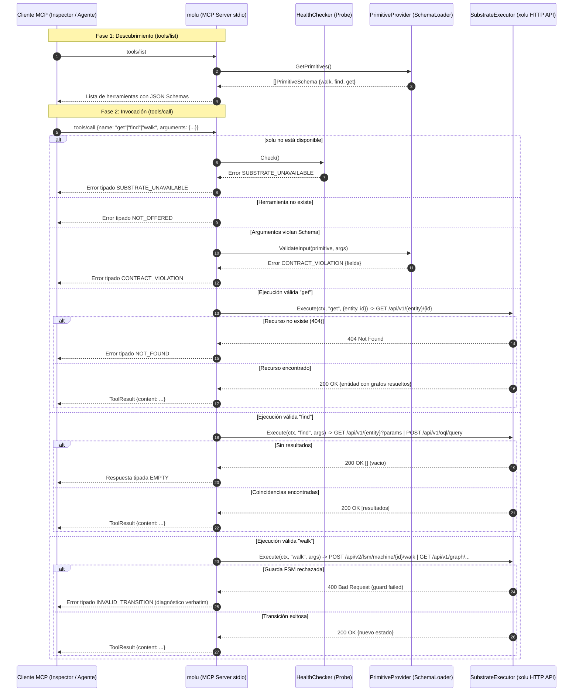

# Plan Técnico: Spec 006 — Servidor MCP Stdio y Despachador de Primitivos en Molu Frontend

## Archivos y Responsabilidades

| Archivo | Responsabilidad |
|---------|-----------------|
| `pkg/mcp/server.go` | **Crear**: `Server` MCP desacoplado que registra herramientas dinámicamente a partir de `PrimitiveSchema`, atiende `tools/list` y despacha `tools/call` validando esquemas (`CONTRACT_VIOLATION`), disponibilidad (`SUBSTRATE_UNAVAILABLE`) y existencia (`NOT_OFFERED`). |
| `pkg/mcp/server_test.go` | **Crear**: Tests unitarios con mocks: handshake inicial, `tools/list` vacío y con primitivos, `tools/call` exitoso, violación de contrato, sustrato caído, herramienta no ofrecida, refresco atómico de herramientas y concurrencia (-race). |
| `cmd/molu/main.go` | **Modificar**: Wiring del servidor MCP con `SchemaLoader` y `Probe`, arranque sobre `stdio` (`server.ServeStdio`) y notificación de refresco ante `SIGHUP`. Logs dirigidos exclusivamente a `os.Stderr`. |
| `docs/diagrams/006-mcp-server-stdio-sequence.mmd` | **Crear**: Diagrama de secuencia Mermaid detallando el flujo de inicialización, listado de primitivos, invocación exitosa y bifurcaciones de error tipado. |

---

## Modelos y Contratos

### Interfaces Desacopladas (para inyección y testabilidad)

```go
// PrimitiveProvider provee los esquemas de primitivos activos (satisfecho por *schema.SchemaLoader)
type PrimitiveProvider interface {
    GetPrimitives() []schema.PrimitiveSchema
    ValidateInput(primitiveName string, input map[string]interface{}) *taxonomy.TypedError
}

// HealthChecker provee la compuerta de disponibilidad (satisfecho por *exec.Probe)
type HealthChecker interface {
    Check() *taxonomy.TypedError
}

// SubstrateExecutor ejecuta operaciones contra xolu (satisfecho por *xolu.HTTPXoluClient)
type SubstrateExecutor interface {
    Execute(ctx context.Context, primitive string, args map[string]interface{}) (map[string]interface{}, error)
}
```

El mapeo interno de `SubstrateExecutor` contra los endpoints de `xolu` es:
- **`get`**: Extrae `entity` e `id` (o `entity:id`) e invoca `GET /api/v1/{entity}/{id}`. Si xolu retorna 404, traduce a error tipado `NOT_FOUND`.
- **`find`**:
  - Si los argumentos contienen `query`: ejecuta `POST /api/v1/oql/query` con `{"query": "..."}`.
  - Si contienen `search`: ejecuta `GET /api/v1/search?q={search}`.
  - Si contienen `entity` y filtros: ejecuta `GET /api/v1/{entity}?{k}={v}`.
  - Si el array resultante está vacío, traduce a código tipado `EMPTY`.
- **`walk`**:
  - Si contiene `machine_id` / `machine`: ejecuta transición FSM vía `POST /api/v2/fsm/machine/{id}/walk`. Si xolu rechaza la guarda, traduce a `INVALID_TRANSITION`.
  - Si contiene `node_id` / `node`: navega el grafo vía `GET /api/v1/graph/{node_id}/out` o `POST /api/v1/graph/path`.

### Configuración del Servidor (`ServerConfig`)
- `Provider`: `PrimitiveProvider`
- `Health`: `HealthChecker`
- `Executor`: `SubstrateExecutor`
- `CallTimeout`: `time.Duration`

---

## Diagrama de Secuencia (Mermaid)



---

## Concurrencia y Resiliencia
- **Thread-Safety**: El catálogo interno de herramientas MCP se protege mediante `sync.RWMutex` para permitir lecturas concurrentes rápidas (`tools/list` y validación) y swaps atómicos durante recargas (`Refresh`).
- **Gating de Disponibilidad**: Antes de cualquier invocación a xolu, se evalúa `probe.Check()`. Si la sonda reporta desconexión, no se envía tráfico a la red y se responde de inmediato con `SUBSTRATE_UNAVAILABLE` y los metadatos de retroceso exponencial.
- **Aislamiento de Stdio**: Todo logging de la aplicación (`slog`) debe estar estrictamente configurado sobre `os.Stderr`. Escribir texto no JSON-RPC en `os.Stdout` corrompe la sesión del cliente MCP y aborta la conexión.

---

## Decisiones Técnicas y Alternativas Descartadas

- **Decisión 1: Estricto origen de esquemas en xolu (Sin fallback/mock en producción)**:
  - *Justificación*: Mandato del usuario y principio rector §2.4 ("prohibido usar padding"). Si xolu no provee esquemas, molu no debe inventar primitivos arbitrarios.
  - *Alternativa descartada*: Primitivos hardcodeados por defecto en caso de 404 de xolu.
- **Decisión 2: Desacoplamiento del servidor MCP en `pkg/mcp/server.go`**:
  - *Justificación*: Permite probar `tools/list` y `tools/call` al 100% con tests unitarios y de concurrencia aislados sin requerir procesos de terminal ni sockets reales.
  - *Alternativa descartada*: Escribir toda la lógica de handlers directamente dentro de `cmd/molu/main.go`.

---

## Matriz de Cobertura de Requisitos

- **RF-1 (Ciclo de vida stdio)**: Cubierto por `pkg/mcp/server.go` y wiring en `cmd/molu/main.go`.
- **RF-2 (tools/list con primitivos genéricos sin namespace)**: Cubierto por `server.go:HandleListTools()` y `TestServer_ListTools`.
- **RF-3 (tools/call validación → CONTRACT_VIOLATION)**: Cubierto por `server.go:HandleCallTool()` y `TestServer_CallTool_ContractViolation`.
- **RF-4 (tools/call gating → SUBSTRATE_UNAVAILABLE)**: Cubierto por `server.go:HandleCallTool()` y `TestServer_CallTool_SubstrateUnavailable`.
- **RF-5 (tools/call desconocida → NOT_OFFERED)**: Cubierto por `server.go:HandleCallTool()` y `TestServer_CallTool_NotOffered`.
- **RF-6 (Hot-reload y notificación)**: Cubierto por `server.go:UpdatePrimitives()` y `TestServer_UpdatePrimitives`.
- **RF-7 (Concurrencia segura y cero races)**: Cubierto por `TestServer_Concurrency` (`go test -v -race`).
- **RF-8 (Neutralidad de dominio)**: Verificado por compilación y ausencia de referencias a "Seam".

---

## Estrategia de Tests
- **Unitarios (`pkg/mcp/server_test.go`)**:
  - `TestServer_InitializeAndListTools`: Lista herramientas según esquemas provistos.
  - `TestServer_CallTool_Success`: Ejecución válida devuelve resultado esperado.
  - `TestServer_CallTool_ContractViolation`: Campos faltantes o tipos erróneos devuelven código `CONTRACT_VIOLATION`.
  - `TestServer_CallTool_SubstrateUnavailable`: Sonda en estado caído bloquea y devuelve `SUBSTRATE_UNAVAILABLE`.
  - `TestServer_CallTool_NotOffered`: Herramienta no registrada devuelve `NOT_OFFERED`.
  - `TestServer_Concurrency`: Llamadas simultáneas a `ListTools`, `CallTool` y `UpdatePrimitives` bajo `-race`.
- **Integración (`cmd/molu/main.go`)**:
  - Verificación en vivo mediante MCP Inspector (`make inspector`).
