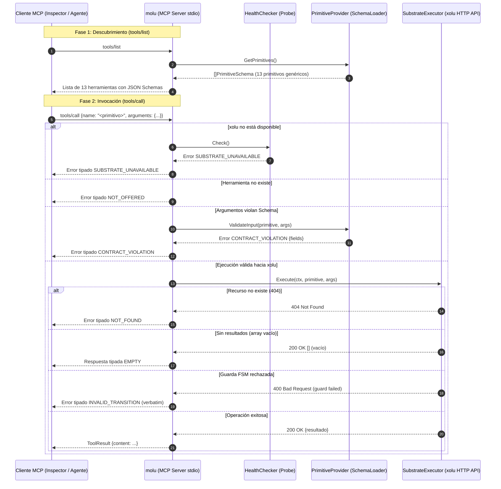

# Plan Técnico: Spec 006 — Servidor MCP Stdio y Despachador de Primitivos en Molu Frontend

## Archivos y Responsabilidades

| Archivo | Responsabilidad |
|---------|-----------------|
| `pkg/mcp/server.go` | **Actualizar/Completar**: Servidor MCP que registra y expone dinámicamente los 13 primitivos genéricos en `tools/list` y despacha `tools/call` validando esquemas (`CONTRACT_VIOLATION`), disponibilidad (`SUBSTRATE_UNAVAILABLE`) y existencia (`NOT_OFFERED`). |
| `pkg/mcp/primitives.go` | **Crear/Extraer**: Definiciones estandarizadas de los 13 esquemas MCP primitivos (§5.1: `describe`, `get`, `list`, `create`, `update`, `query`, `walk`, `machine_state`, `machine_history`, `cal_check`, `cal_openings`, `cal_propose`, `cal_confirm`). |
| `pkg/mcp/server_test.go` | **Extender**: Tests unitarios con mocks para ciclo de vida MCP, `tools/list` con los 13 primitivos, `tools/call` para cada primitivo, bifurcaciones de error de taxonomía, recarga atómica y concurrencia (-race). |
| `cmd/molu/main.go` | **Modificar**: Wiring del servidor MCP con `SchemaLoader`, `Probe` y `HTTPXoluClient`, inicialización sobre `stdio` (`server.ServeStdio`) y logs estrictos a `os.Stderr`. |
| `docs/diagrams/006-mcp-server-stdio-sequence.mmd` | **Actualizar**: Diagrama de secuencia Mermaid detallando el flujo de inicialización, listado de 13 primitivos, invocación exitosa y bifurcaciones de error tipado. |

---

## Modelos y Contratos

### Interfaces Desacopladas (para inyección y testabilidad)

```go
// PrimitiveProvider provee los esquemas de primitivos activos y la validación de contratos
type PrimitiveProvider interface {
    GetPrimitives() []schema.PrimitiveSchema
    ValidateInput(primitiveName string, input map[string]interface{}) *taxonomy.TypedError
}

// HealthChecker provee la compuerta de disponibilidad (satisfecho por *exec.Probe)
type HealthChecker interface {
    Check() error
}

// SubstrateExecutor ejecuta operaciones contra xolu (satisfecho por *xolu.HTTPXoluClient)
type SubstrateExecutor interface {
    Execute(ctx context.Context, primitive string, args map[string]interface{}) (map[string]interface{}, error)
}
```

### Mapeo de los 13 Primitivos en `SubstrateExecutor`

1. **`describe`**: Consulta el mapa semántico/catálogo de esquemas local según `scope` ("all", "entities", "machines", "generators", "events") y `name` opcional.
2. **`get`**: Extrae `entity_type` e `id` e invoca `GET /api/v1/{entity_type}/{id}`. Mapea 404 a `NOT_FOUND`.
3. **`list`**: Invoca `GET /api/v1/{entity_type}?{filters}&limit={limit}&offset={offset}`. Si la lista está vacía, emite `EMPTY`.
4. **`create`**: Invoca `POST /api/v1/{entity_type}` con `data`. Si el esquema es inválido, emite `CONTRACT_VIOLATION`.
5. **`update`**: Invoca `PATCH /api/v1/{entity_type}/{id}` con `changes` y `version`.
6. **`query`**: Invoca `POST /api/v1/oql/query` (o motor Sulpher) con `query` y `params`. Si no hay resultados, emite `EMPTY`.
7. **`walk`**: Invoca `POST /api/v2/fsm/machine/{id}/walk` con `input` y `payload`. Si la guarda falla, emite `INVALID_TRANSITION` (diagnóstico verbatim).
8. **`machine_state`**: Invoca `GET /api/v2/fsm/machine/{id}/state` y fusiona con `/vars`.
9. **`machine_history`**: Invoca `GET /api/v2/fsm/machine/{id}/history` con `limit`. Si no hay entradas, emite `EMPTY`.
10. **`cal_check`**: Invoca `POST /api/v1/cal/check` con `calendars`, `start`, `end`.
11. **`cal_openings`**: Invoca `POST /api/v1/cal/openings` con `calendars`, `duration`, `from`, `to`, `objective`, `limit`. Si no hay ventanas, emite `EMPTY`.
12. **`cal_propose`**: Invoca `POST /api/v1/cal/propose` con `calendars`, `start`, `end`, `payload`. Retorna `booking_id`.
13. **`cal_confirm`**: Invoca `POST /api/v1/cal/confirm` con `booking_id`. Si no existe, emite `NOT_FOUND`.

---

## Diagrama de Secuencia (Mermaid)



---

## Concurrencia y Resiliencia
- **Thread-Safety**: Catálogo interno protegido mediante `sync.RWMutex` para consultas concurrentes de `tools/list` y llamadas `tools/call`.
- **Gating de Disponibilidad**: Verificación con `probe.Check()` previa a cualquier llamada de red.
- **Aislamiento Stdio**: Todo log de telemetría/sistema dirigido a `os.Stderr`.
