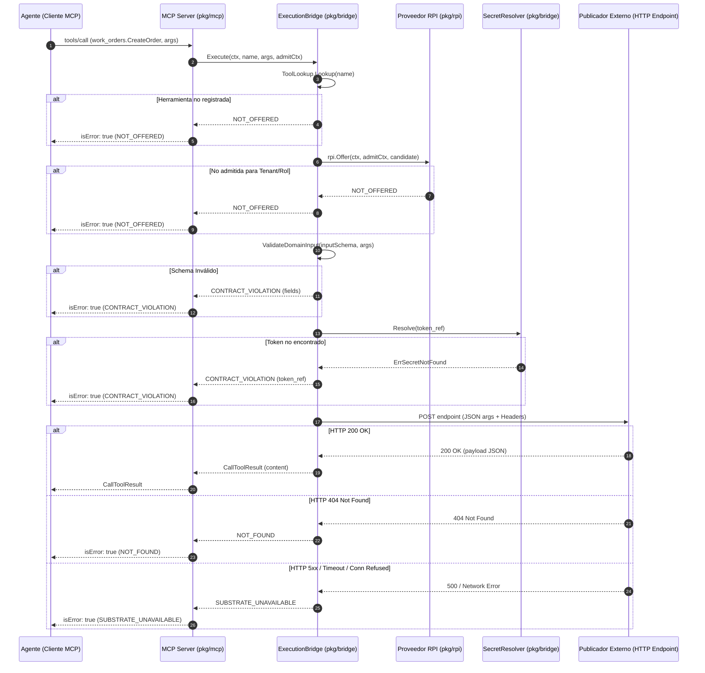

# Plan Técnico: Spec 008 — Execution Bridge para Funciones de Dominio del Hub

## Archivos y Responsabilidades
- `pkg/bridge/types.go`: Definición de interfaces (`ToolLookup`, `SecretResolver`, `HTTPClient`, `DomainExecutor`) y tipos de datos para contratos de dominio (`AuthMetadata`, `DomainCallParams`, `DomainCallResult`).
- `pkg/bridge/resolver.go`: Implementación de `EnvSecretResolver` que resuelve `token_ref` a partir de variables de entorno (`MOLU_FRONT_TOKEN_<REF>`) o archivos (`MOLU_FRONT_TOKEN_<REF>_FILE`), normalizando identificadores.
- `pkg/bridge/validator.go`: Función pura `ValidateDomainInput(schemaMap, args)` usando `gojsonschema` para verificar los argumentos y devolver `CONTRACT_VIOLATION` con `details.fields[]`.
- `pkg/bridge/caller.go`: Implementación de `HTTPDomainCaller` que efectúa la llamada HTTP POST al endpoint del publicador, inyecta headers de autenticación y trazabilidad (`X-Request-ID`, `traceparent`), interpreta status HTTP (200, 404, 5xx), detecta colecciones vacías (`EMPTY`) y errores `XOLU-*` verbatim.
- `pkg/bridge/bridge.go`: Orquestador `ExecutionBridge` que implementa `DomainExecutor`, encapsulando el flujo completo: verificación en `ToolLookup` $\rightarrow$ admisión RPI con `rpi.Offer` $\rightarrow$ validación de esquema $\rightarrow$ resolución de auth $\rightarrow$ llamada HTTP passthrough.
- `pkg/mcp/server.go`: Integración en el servidor MCP: adición de `DomainExecutor` y `CatalogLookup` en `ServerConfig`, actualización de `isToolOffered` y despacho en `executeTool` cuando la herramienta invocada contiene namespace (`.`).
- `pkg/config/config.go`: Adición de variables de configuración para el bridge (`MOLU_FRONT_DOMAIN_CALL_TIMEOUT`, con default de `30s`).
- `cmd/molu/main.go`: Cableado en el frontal MCP inyectando el `hub.Registry`, el proveedor RPI, el logger y las métricas en el bridge.
- `docs/diagrams/008-execution-bridge-sequence.mmd`: Diagrama de secuencia Mermaid con los flujos de éxito, validación y errores de taxonomía.

## Modelos y Contratos

### Tipos de Autenticación y Metadatos de Dominio
```go
type AuthMode string

const (
    AuthModeNone   AuthMode = "none"
    AuthModeBearer AuthMode = "bearer"
    AuthModeAPIKey AuthMode = "apikey"
)

type AuthMetadata struct {
    Mode     AuthMode `json:"mode"`
    Header   string   `json:"header"`
    TokenRef string   `json:"token_ref"`
}
```

### Interfaces Desacopladas
```go
// ToolLookup permite al bridge obtener la definición de una herramienta por su nombre.
type ToolLookup interface {
    Lookup(name string) (hub.ToolRegistration, bool)
}

// SecretResolver resuelve un token_ref a un string secreto.
type SecretResolver interface {
    Resolve(tokenRef string) (string, error)
}

// DomainExecutor ejecuta una llamada a una función de dominio.
type DomainExecutor interface {
    Execute(ctx context.Context, toolName string, args map[string]any, actx rpi.AdmitContext) (any, error)
}
```

### Mapeo a Taxonomía Tipada
- **`NOT_OFFERED`**: Herramienta no encontrada en `ToolLookup` o rechazada por `rpi.Offer(ctx, actx, toolCandidate)`.
- **`CONTRACT_VIOLATION`**: Argumentos no cumplen `inputSchema` (`details.fields[]`) o `token_ref` requerido no configurado.
- **`NOT_FOUND`**: Endpoint del publicador responde HTTP 404.
- **`SUBSTRATE_UNAVAILABLE`**: Timeout de red, conexión rechazada o error HTTP 5xx del publicador (incluye `RetryMetadata`).
- **`EMPTY`**: Respuesta HTTP 200 con estructura de colección vacía (`data: []`, `items: []`, `rows: []`, etc.).
- **`INVALID_TRANSITION`**: Respuesta del publicador con sobre de error xolu conteniendo código o diagnóstico de guarda FSM.

## Diagrama de Secuencia (Mermaid)



## Concurrencia y Resiliencia
- `http.Client` reutilizable configurado con timeout acotado (`MOLU_FRONT_DOMAIN_CALL_TIMEOUT`, default `30s`) y transporte con límites de conexión por host.
- Soporte total de cancelación y timeouts a través de `context.Context`.
- Operaciones de resolución de secretos y lectura de catálogo thread-safe protegidas contra data races (`go test -v -race ./...`).

## Decisiones Técnicas y Alternativas Descartadas
- **D1: Paquete `pkg/bridge` dedicado**: Mantiene el desacoplamiento limpio entre la capa de protocolo MCP (`pkg/mcp`), el catálogo del Hub (`pkg/hub`) y el cliente nativo de xolu (`pkg/xolu`).
  - *Alternativa descartada*: Incrustar la lógica HTTP dentro de `pkg/mcp/server.go`. Se descartó para no inflar el servidor de transporte y permitir pruebas con mocks independientes.
- **D2: Normalización de `token_ref` a variables de entorno**: `vault:token-1` se mapea a `MOLU_FRONT_TOKEN_VAULT_TOKEN_1`, y si existe `MOLU_FRONT_TOKEN_VAULT_TOKEN_1_FILE`, se lee el archivo.
  - *Alternativa descartada*: Un único archivo JSON central de contraseñas. Se descartó por ser menos idiomático en contenedores y despliegues Kubernetes donde los secretos se montan como archivos o variables de entorno individuales.
- **D3: Reutilización de `rpi.Offer`**: Se invoca `rpi.Offer` para garantizar coherencia con la Spec 004/005, asegurando que si una herramienta no pasa el filtro de admisión de RPI para el tenant/rol, la llamada sea rechazada con `NOT_OFFERED` antes de salir por la red.

## Matriz de Cobertura de Requisitos
- **RF-1, RF-2**: `ExecutionBridge.Execute` verifica registro y llama a `rpi.Offer` $\rightarrow$ `TestBridge_NotOffered`
- **RF-3, RF-4**: `ValidateDomainInput` con `gojsonschema` $\rightarrow$ `TestValidateDomainInput_ContractViolation`
- **RF-5, RF-6**: `EnvSecretResolver` y chequeo de credenciales $\rightarrow$ `TestEnvSecretResolver`, `TestBridge_MissingSecret`
- **RF-7**: `HTTPDomainCaller` respuesta 200 passthrough $\rightarrow$ `TestHTTPDomainCaller_Success`
- **RF-8**: Status 404 mapeado a `NOT_FOUND` $\rightarrow$ `TestHTTPDomainCaller_NotFound`
- **RF-9**: Status 5xx / timeout mapeado a `SUBSTRATE_UNAVAILABLE` $\rightarrow$ `TestHTTPDomainCaller_SubstrateUnavailable`
- **RF-10**: Colección vacía mapeada a `EMPTY` $\rightarrow$ `TestHTTPDomainCaller_Empty`
- **RF-11**: Código de error xolu (`XOLU-*`) verbatim $\rightarrow$ `TestHTTPDomainCaller_VerbatimXoluError`
- **RF-12**: Ejecución concurrente sin data races $\rightarrow$ `TestBridge_Concurrency`
- **RF-13**: Neutralidad de dominio $\rightarrow$ test de verificación de ausencia de "Seam" en el paquete

## Estrategia de Tests
1. **Tests Unitarios**:
   - `pkg/bridge/resolver_test.go`: Normalización de nombres de variables, lectura de env, lectura de `_FILE`, manejo de archivos inexistentes.
   - `pkg/bridge/validator_test.go`: Payloads válidos, campos requeridos faltantes, tipos incorrectos, esquemas vacíos.
   - `pkg/bridge/caller_test.go`: Servidor HTTP de prueba (`httptest.Server`) simulando 200, 404, 500, timeouts, headers de auth (`Bearer`, `apikey`), y cuerpos con código xolu verbatim.
   - `pkg/bridge/bridge_test.go`: Flujo orquestado con mocks de `ToolLookup` y `RPIProvider`.
2. **Tests de Integración**:
   - `pkg/bridge_integration/bridge_integration_test.go`: Invocación punta a punta a través de `mcp.Server.HandleMessage` simulando `tools/call` para funciones de dominio, validando que el resultado viaje en `CallToolResult` o como `isError: true` con los 5 códigos de la taxonomía tipada (§2.4).
