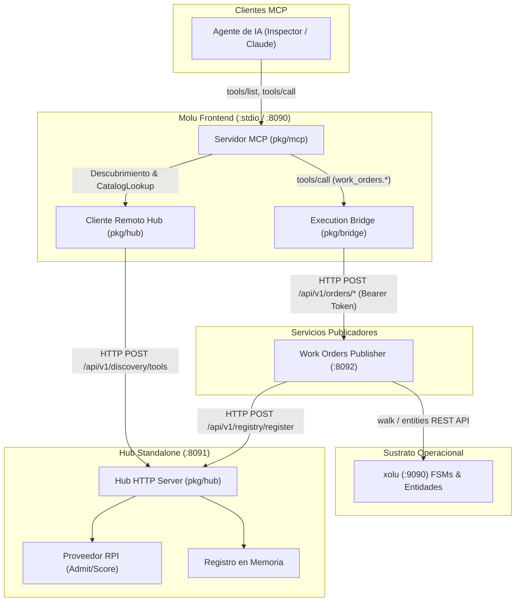

# Plan Técnico: Spec 009 — Hub Standalone y Publicador Piloto de Work Orders

## Objetivos del Plan
1. **Desacoplar el Hub de Molu** creando el servicio y binario independiente `cmd/hub` con transporte HTTP (`:8091`) para registro de publicadores y descubrimiento RPI.
2. **Implementar el Cliente Remoto de Hub en Molu** (`pkg/hub/client.go`), permitiendo a `molu` consumir el Hub desacoplado vía HTTP (`MOLU_FRONT_HUB_URL`).
3. **Construir el Publicador Piloto de Work Orders** (`cmd/publisher-orders`), que se auto-registra en el Hub con contratos JSON, atiende peticiones en `:8092`, y delega operaciones y transiciones FSM hacia xolu.
4. **Verificar el Criterio 1 de Aceptación Crítica** mediante una prueba de integración E2E punta a punta: Cliente MCP $\rightarrow$ Molu $\rightarrow$ Hub $\rightarrow$ Publisher $\rightarrow$ xolu FSM con rechazo verbatim de guarda.

---

## Arquitectura de Servicios y Comunicación



---

## Fases y Paquetes de Trabajo

### Fase 1: Hub Standalone (`bin/hub`) y Cliente Remoto en Molu

#### 1. Servidor HTTP del Hub (`pkg/hub/http_server.go`)
- Estructura `HubHTTPServer` que expone:
  - `POST /api/v1/registry/register`: Deserializa `hub.ToolRegistration`, valida y registra en `hub.Registry`. Retorna 200 OK o 400 `CONTRACT_VIOLATION`.
  - `POST /api/v1/registry/unregister`: Elimina herramienta. Retorna 200 OK o 404 `NOT_FOUND`.
  - `POST /api/v1/registry/list`: Retorna el catálogo completo o filtrado por `publisher_id`.
  - `POST /api/v1/discovery/tools`: Deserializa `rpi.AdmitContext` (`tenant`, `roles`, `query`). Invoca `discovery.ListTools`. Si `tenant` vacío $\rightarrow$ 400 `CONTRACT_VIOLATION`. Si no hay herramientas $\rightarrow$ 200 con `EMPTY` taxonomía.
  - `GET /healthz`: Health check básico HTTP 200.

#### 2. Binario del Hub (`cmd/hub/main.go`)
- Lee configuración de entorno:
  - `MOLU_HUB_HTTP_ADDR` (default `:8091`).
  - `MOLU_HUB_RPI_PROVIDER` (default `admit-all`).
  - `MOLU_HUB_RPI_RULES_FILE` / `MOLU_HUB_RPI_RULES_JSON`.
- Ensambla `hub.Registry`, `rpi.RPIProvider`, `hub.Discovery`, `hub.PublisherAPI`.
- Inicia el servidor HTTP con graceful shutdown ante `SIGINT`/`SIGTERM`.

#### 3. Cliente Remoto de Hub (`pkg/hub/client.go`)
- Estructura `RemoteHubClient` que implementa:
  - `mcp.CatalogLookup`: método `Lookup(name string) (hub.ToolRegistration, bool)` consultando `/api/v1/registry/list`.
  - `mcp.ToolDiscoverer`: método `ListTools(ctx context.Context, actx rpi.AdmitContext) ([]rpi.ScoredTool, error)` consultando `/api/v1/discovery/tools`.
- Soporta timeout configurable y propaga errores tipados de taxonomía sin colapsarlos.

#### 4. Wiring en Molu (`cmd/molu/main.go` & `pkg/config/config.go`)
- Variable `MOLU_FRONT_HUB_URL` (string opcional).
- Si `cfg.HubURL != ""` $\rightarrow$ Molu utiliza `RemoteHubClient`. Si está vacía $\rightarrow$ mantiene el registro local en memoria (fallback para tests unitarios locales).

---

### Fase 2: Publicador Piloto de Work Orders (`bin/publisher-orders`)

#### 1. Dominio y Lógica de Negocio (`pkg/publisher/orders/service.go`)
- Entidad `WorkOrder`:
  - `ID`: string (UUID o secuencial `WO-xxxx`).
  - `Tenant`: string.
  - `Title`: string.
  - `Description`: string.
  - `Priority`: `low` | `medium` | `high` | `critical`.
  - `State`: FSM de ciclo de vida (`created` $\rightarrow$ `in_progress` $\rightarrow$ `completed` / `cancelled`).
- Métodos:
  - `CreateOrder(ctx, req)`: Registra la orden e inicializa la FSM.
  - `AdvanceOrder(ctx, req)`: Invoca la transición en xolu (`walk`). Si la transición no es válida (ej. saltar de `created` a `completed`), propaga el error `XOLU-INVALID_TRANSITION` con el mensaje exacto de la guarda de xolu.
  - `GetOrder(ctx, id)`: Obtiene la orden. Si no existe, retorna error mapeable a 404 (`NOT_FOUND`).

#### 2. Servidor HTTP del Publicador (`pkg/publisher/orders/server.go`)
- Endpoints HTTP en `:8092`:
  - `POST /api/v1/orders/create`
  - `POST /api/v1/orders/advance`
  - `POST /api/v1/orders/get`
  - `GET /healthz`
- Middleware de autenticación Bearer: verifica que la cabecera `Authorization: Bearer <token>` coincida con el secreto local del publicador (`MOLU_PUBLISHER_AUTH_TOKEN`).

#### 3. Auto-registro en el Hub (`pkg/publisher/orders/registrar.go`)
- Al iniciar, invoca `POST /api/v1/registry/register` en el Hub para cada función:
  - `work_orders.CreateOrder`:
    - `endpoint`: `http://localhost:8092/api/v1/orders/create`
    - `auth`: `{ mode: "bearer", token_ref: "orders:api-token" }`
    - `inputSchema`: Schema JSON con campos `tenant`, `title`, `description`, `priority`.
  - `work_orders.AdvanceOrder`:
    - `endpoint`: `http://localhost:8092/api/v1/orders/advance`
    - `auth`: `{ mode: "bearer", token_ref: "orders:api-token" }`
    - `inputSchema`: Schema JSON con campos `order_id`, `event` (`start`, `complete`, `cancel`), `payload`.
  - `work_orders.GetOrder`:
    - `endpoint`: `http://localhost:8092/api/v1/orders/get`
    - `auth`: `{ mode: "bearer", token_ref: "orders:api-token" }`
    - `inputSchema`: Schema JSON con campo `order_id`.
- Reintentos con backoff exponencial si el Hub no está listo inmediatamente.
- Desregistro limpio al recibir señales de terminación (`SIGINT`/`SIGTERM`).

#### 4. Binario del Publicador (`cmd/publisher-orders/main.go`)
- Lee variables de configuración:
  - `MOLU_PUBLISHER_HTTP_ADDR` (default `:8092`).
  - `MOLU_PUBLISHER_HUB_URL` (default `http://localhost:8091`).
  - `MOLU_PUBLISHER_XOLU_URL` (default `http://localhost:9090`).
  - `MOLU_PUBLISHER_AUTH_TOKEN` (default `orders-secret-key-123`).

---

### Fase 3: Integración E2E y Validación del Criterio 1

#### 1. Prueba de Integración E2E (`pkg/bridge_integration/criterio1_e2e_test.go`)
- Levanta en el test los tres componentes desacoplados con sockets HTTP reales (o puertos libres):
  1. `HubHTTPServer` en puerto dinámico.
  2. `OrderPublisherServer` en puerto dinámico, auto-registrado en el Hub.
  3. `Molu MCP Server` con `RemoteHubClient` y `ExecutionBridge` configurado con `MOLU_FRONT_TOKEN_ORDERS_API_TOKEN`.
- Flujo de prueba:
  - **Paso 1: Descubrimiento**: Invoca `tools/list` con tenant válido. Verifica que `work_orders.CreateOrder`, `work_orders.AdvanceOrder` y `work_orders.GetOrder` están en la lista ofrecida.
  - **Paso 2: Creación**: Invoca `tools/call` para `work_orders.CreateOrder`. Verifica HTTP 200 y recepción de `order_id` con estado `created`.
  - **Paso 3: Rechazo FSM visible (Criterio 1)**: Invoca `tools/call` para `work_orders.AdvanceOrder` intentando evento `complete` directo desde `created`. Verifica que la respuesta es un error tipado `isError: true` con código `INVALID_TRANSITION` y diagnóstico de guarda verbatim.
  - **Paso 4: Not Found**: Invoca `tools/call` para `work_orders.GetOrder` con ID inexistente. Verifica error tipado `NOT_FOUND`.

#### 2. Actualización de Makefile
- Actualizar `make build` para generar los 3 binarios:
  ```makefile
  build:
  	go build -o bin/molu cmd/molu/main.go
  	go build -o bin/hub cmd/hub/main.go
  	go build -o bin/publisher-orders cmd/publisher-orders/main.go
  ```

---

## Matriz de Cobertura de Requisitos Funcionales (EARS)

| Requisito | Componente | Descripción de la Verificación |
| :--- | :--- | :--- |
| **RF-1** | `cmd/hub` | Arranque del Hub HTTP con configuración de entorno `MOLU_HUB_*`. |
| **RF-2** | `pkg/hub/http_server.go` | Endpoint `POST /api/v1/registry/register` y validación de contrato. |
| **RF-3** | `pkg/hub/http_server.go` | Endpoint `POST /api/v1/registry/unregister` y manejo de `NOT_FOUND`. |
| **RF-4** | `pkg/hub/http_server.go` | Endpoint `POST /api/v1/discovery/tools` con RPI Admit/Score y códigos `EMPTY`/`CONTRACT_VIOLATION`. |
| **RF-5** | `pkg/hub/client.go` | `RemoteHubClient` en Molu consumiendo el Hub remoto vía HTTP. |
| **RF-6** | `pkg/publisher/orders/registrar.go` | Auto-registro de funciones de Work Orders en el Hub remoto con `token_ref`. |
| **RF-7** | `pkg/publisher/orders/service.go` | `POST /api/v1/orders/create` crea entidad y FSM en xolu. |
| **RF-8** | `pkg/publisher/orders/service.go` | `POST /api/v1/orders/get` retorna 404 ante orden inexistente (`NOT_FOUND`). |
| **RF-9** | `pkg/publisher/orders/service.go` | `POST /api/v1/orders/advance` rechaza transición inválida y retorna `XOLU-INVALID_TRANSITION` verbatim. |
| **RF-10** | `pkg/publisher/orders/server.go` | Middleware Bearer retorna 401 ante token ausente o inválido. |
| **RF-11** | `pkg/publisher/orders/service.go` | Retorno de `XOLU-SUBSTRATE_UNAVAILABLE` si xolu no responde. |
| **RF-12** | `pkg/publisher/orders/registrar.go` | Desregistro ordenado en Hub ante shutdown (SIGINT/SIGTERM). |
| **RF-13** | Todos | Ausencia de data races validada con `go test -v -race ./...`. |
| **RF-14** | Todos | Neutralidad estricta (cero menciones al término restringido). |

---

## Estrategia de Testing TDD
- **TDD Rojo-Verde**: Para cada micro-tarea, escribir primero el test (`*_test.go`), verificar el fallo, implementar el código mínimo, y verificar el pase bajo `go test -v -race ./...`.
- **Tests concurrentes**: Pruebas de estrés y concurrencia con múltiples goroutines en registro, discovery y llamadas de dominio.
- **Neutralidad**: Validación con `grep -ri seam cmd/ pkg/` asegurando cero coincidencias.

