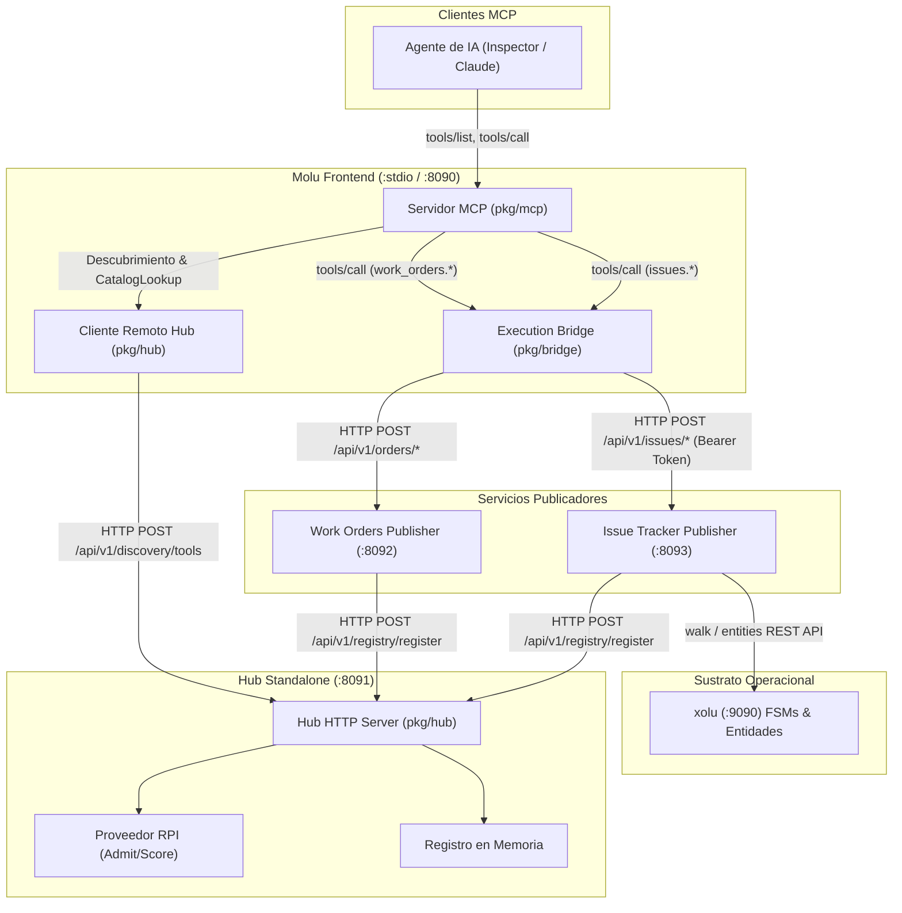

# Plan Técnico: Spec 010 — Publicador de Issue Tracker

## Objetivos del Plan
1. **Implementar el Dominio y Servicio de Issue Tracker** (`pkg/publisher/issues/types.go` y `service.go`), calculando SLA, resolviendo criticidad de activos e interactuando con xolu FSM y entidades.
2. **Construir el Servidor HTTP y Middleware de Autenticación** (`pkg/publisher/issues/server.go`) en `:8093` con endpoints `/api/v1/issues/create`, `/advance`, `/get` y `/healthz`.
3. **Implementar el Auto-Registro y Ciclo de Vida** (`pkg/publisher/issues/registrar.go`) para publicar las herramientas `issues.CreateIssue`, `issues.AdvanceIssue` e `issues.GetIssue` en el Hub Standalone con metadatos de autenticación `token_ref: "issues:api-token"`.
4. **Crear el Binario y Target en Makefile** (`cmd/publisher-issues/main.go` y `bin/publisher-issues`).
5. **Asegurar Concurrencia y Neutralidad Estricta** bajo `go test -v -race ./...` y `grep -ri seam cmd/ pkg/`.

---

## Arquitectura de Servicios y Comunicación

---

## Fases y Paquetes de Trabajo

### Fase 1: Dominio y Lógica de Negocio (`pkg/publisher/issues/service.go`)
- Estructura `Issue` con campos de ciclo de vida y SLA.
- Cálculo de plazos SLA de primera respuesta y resolución según prioridad (`critical`, `high`, `medium`, `low`) y criticidad de activo (`critical`, `normal`).
- Creación de entidades `issues` y máquinas FSM `issue_lifecycle` en xolu.
- Avance de transiciones FSM (`walk`) preservando rechazos `XOLU-INVALID_TRANSITION` verbatim.

### Fase 2: Servidor HTTP del Publicador (`pkg/publisher/issues/server.go`)
- Endpoints HTTP en `:8093`:
  - `POST /api/v1/issues/create`
  - `POST /api/v1/issues/advance`
  - `POST /api/v1/issues/get`
  - `GET /healthz`
- Middleware Bearer Auth (`MOLU_PUBLISHER_ISSUES_AUTH_TOKEN`).

### Fase 3: Auto-registro en el Hub (`pkg/publisher/issues/registrar.go`)
- Registro de `issues.CreateIssue`, `issues.AdvanceIssue` e `issues.GetIssue` en el Hub remoto.
- Metadatos con `endpoint`, `auth.mode: "bearer"` y `auth.token_ref: "issues:api-token"`.
- Reintentos con backoff al arranque y desregistro en `SIGINT`/`SIGTERM`.

### Fase 4: Binario y Makefile (`cmd/publisher-issues/main.go`)
- Punto de entrada con variables `MOLU_PUBLISHER_ISSUES_*`.
- Makefile target `build` actualizado.

---

## Matriz de Cobertura de Requisitos Funcionales

| Requisito | Componente | Descripción de la Verificación |
| :--- | :--- | :--- |
| **RF-1** | `pkg/publisher/issues/service.go` | `CreateIssue` valida campos, resuelve activo, calcula SLA y persiste en xolu. |
| **RF-2** | `pkg/publisher/issues/service.go` | `GetIssue` retorna `NOT_FOUND` si la incidencia no existe. |
| **RF-3** | `pkg/publisher/issues/service.go` | `AdvanceIssue` propaga `XOLU-INVALID_TRANSITION` verbatim ante transición rechazada. |
| **RF-4** | `pkg/publisher/issues/service.go` | `AdvanceIssue` persiste marca de tiempo de primera respuesta al iniciar. |
| **RF-5** | `cmd/publisher-issues/main.go` | Arranque del publicador en `:8093` y registro inicial en el Hub. |
| **RF-6** | `pkg/publisher/issues/server.go` | Middleware Bearer retorna 401 si token es inválido o ausente. |
| **RF-7** | `pkg/publisher/issues/service.go` | Retorno de `XOLU-SUBSTRATE_UNAVAILABLE` si xolu es inalcanzable. |
| **RF-8** | `pkg/publisher/issues/registrar.go` | Desregistro ordenado de herramientas al apagarse el servicio. |
| **RF-9** | Todos | Ausencia de data races validada con `go test -v -race ./...`. |
| **RF-10** | Todos | Neutralidad estricta (cero menciones al término restringido). |
