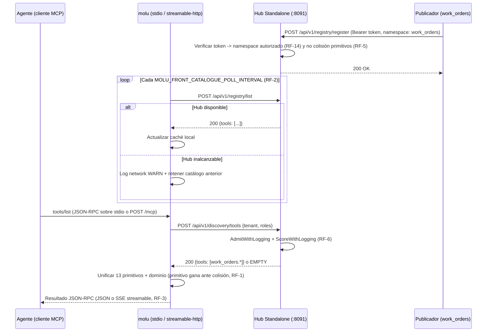

# Plan Técnico: Spec 011 — Cierre de Brechas de Auditoría y Entregables Normativos

## Archivos y Responsabilidades

### Bloque A — Frontal MCP `molu` (RF-1, RF-2, RF-3)
- `pkg/mcp/server.go`: Actualizar `handleDiscoveryList` / despacho de `tools/list` para devolver la **superficie unificada** (13 primitivos genéricos activos + funciones de dominio admitidas por el Hub/RPI). Si el Hub devuelve `EMPTY`, retornar los primitivos genéricos; si `tenant == ""` sin `DefaultTenant`, mantener `CONTRACT_VIOLATION`. Ante colisión de nombre, conservar el primitivo genérico y descartar la función colisionante (§2.6).
- `pkg/mcp/server_hub_test.go`: Actualizar/ampliar tests unitarios verificando unión de primitivos + dominio, fallback a primitivos ante `EMPTY`, preservación de `CONTRACT_VIOLATION` sin tenant, y precedencia del primitivo ante colisión.
- `pkg/hub/client.go`: Añadir caché en memoria thread-safe (`sync.RWMutex`) y método `StartPolling(ctx, interval)` en `RemoteHubClient` para sondeo periódico contra `/api/v1/registry/list` (`MOLU_FRONT_CATALOGUE_POLL_INTERVAL`). Si un sondeo falla, registrar en el logger de red (`pkg/telemetry`) y retener el último catálogo válido (*stale-while-error*); si nunca hubo catálogo válido, propagar `SUBSTRATE_UNAVAILABLE`.
- `pkg/hub/client_test.go`: Tests de sondeo periódico, retención ante caída transitoria del Hub, indisponibilidad inicial y concurrencia bajo `-race`.
- `pkg/mcp/http_transport.go`: Implementar el transporte `streamable-http` (`HTTPHandler` / `ServeHTTP`) sobre `Server.HandleMessage`:
  - `POST /mcp`: acepta JSON-RPC 2.0. Si el cliente envía `Accept: text/event-stream`, responde con stream SSE (`data: <json>\n\n`); en caso contrario, responde `application/json`.
  - `GET /mcp`: abre un stream SSE persistente para notificaciones del servidor (`notifications/tools/list_changed`) con heartbeat y cancelación limpia por contexto.
  - Middleware de autenticación según `MOLU_FRONT_HTTP_AUTH` (`none` | `bearer` leyendo el token de `MOLU_FRONT_HTTP_BEARER_TOKEN_FILE`, retornando HTTP 401 si es inválido).
- `pkg/mcp/http_transport_test.go`: Tests unitarios de POST JSON, POST SSE, GET SSE con notificación `list_changed`, auth `bearer` (válido/inválido) y concurrencia bajo `-race`.
- `cmd/molu/main.go`: Ramificar el arranque según `cfg.Transport` (`stdio` vs `streamable-http` en `cfg.HTTPAddr` con graceful shutdown) e iniciar `remoteHub.StartPolling(ctx, cfg.CataloguePollInterval)` cuando `cfg.HubURL != ""`.

### Bloque B — Hub Standalone y Telemetría de Circuito Completo (RF-4, RF-5, RF-6, RF-14)
- `pkg/hub/registry.go`: Añadir conjunto de nombres reservados de primitivos genéricos estándar (`describe`, `get`, `list`, `create`, `update`, `query`, `walk`, `machine_state`, `machine_history`, `cal_list`, `cal_openings`, `cal_propose`, `cal_confirm`, `find`) para rechazar con `CONTRACT_VIOLATION` (`details.fields: ["name"]`) cualquier registro que colisione con ellos.
- `pkg/hub/registry_test.go`: Tests verificando rechazo ante colisión con primitivos reservados.
- `pkg/hub/discovery.go`: Reemplazar `d.provider.Score(...)` por `rpi.ScoreWithLogging(d.provider, ctx, actx, admitted)` para auditoría simétrica de `Admit` y `Score`.
- `pkg/hub/auth.go`: Implementar `PublisherAuthorizer` (`map[string][]string` — `token -> []namespace`) con carga desde JSON (`MOLU_HUB_PUBLISHER_TOKENS_JSON`) o archivo (`MOLU_HUB_PUBLISHER_TOKENS_FILE`). Soporta comodín `"*"` o coincidencia exacta de namespace; si no hay mapa configurado, opera en modo abierto.
- `pkg/hub/http_server.go`: Integrar middleware de telemetría (correlación `X-Request-ID`/`traceparent`, logs de red/seguridad, métricas Prometheus) y autorización de publicadores (`PublisherAuthorizer`) en `/api/v1/registry/register` y `/api/v1/registry/unregister` (401 sin/mal token, 403 `NOT_OFFERED` si el namespace no está autorizado).
- `pkg/hub/http_server_test.go`: Tests de autorización por namespace (401, 403, 200 autorizado, modo abierto) y propagación de headers de correlación.
- `cmd/hub/main.go`: Inicializar `pkg/telemetry` (`ComponentMoluHub`), servidor de métricas/health si está habilitado, `PublisherAuthorizer` y logger/métricas en el `RPIProvider` y `HubHTTPServer`.

### Bloque C — Interfaz RPI y Extensibilidad Demostrada (RF-7, RF-8)
- `pkg/rpi/admit_score.go`: Definir tipo `Capabilities{ Admit bool, Score bool }` y añadir método `Capabilities() Capabilities` a `RPIProvider`.
- `pkg/rpi/providers/admit_all.go` y `static_context_rules.go`: Implementar `Capabilities()` retornando `{Admit: true, Score: false}`.
- `pkg/rpi/provider_mock.go`: Implementar `Capabilities()` configurable en `MockRPIProvider` (por defecto `{Admit: true, Score: true}`).
- `pkg/rpi/score_double_test.go`: Implementar test double dedicado de solo-puntuación (`ScoringOnlyDouble`) con prueba de conformidad de todas las garantías de §2.5 (referencias, partición previa por tenant, sin padding, error `SUBSTRATE_UNAVAILABLE` si no está disponible, sin tipos internos expuestos).
- `docs/rpi-extensibility.md`: Nota de diseño formal explicando cómo encajar un motor de puntuación semántica/vectorial en la etapa `Score` sin modificar la interfaz `RPIProvider`.

### Bloque D — Documentación Normativa (§2.3.1), Diagramas y ADRs (RF-9, RF-10, RF-11, RF-12, RF-13)
- `docs/deployment.md`: Guía de despliegue unificada de los 4 procesos (`xolu`, `hub`, `publisher-orders`, `molu`), orden tolerado con backoff, puertos/transportes (`stdio` y `streamable-http`) y verificación de conectividad de los 4 servicios.
- `docs/configuration.md`: Sincronización exhaustiva con `pkg/config/config.go`, `cmd/hub/main.go` y `cmd/publisher-orders/main.go` (corrigiendo defaults divergentes y añadiendo todas las variables `MOLU_FRONT_*`, `MOLU_HUB_*` y `MOLU_PUBLISHER_*` con justificación operativa).
- `docs/runbook.md`: Ampliación para cubrir los 6 códigos de taxonomía de §2.4, `XOLU-MOLU-FRONT-TIMEOUT`, corte transitorio vs. intervención manual en xolu, retención de catálogo cuando el Hub deja de actualizarse, y corrección del enlace roto en línea 345.
- `docs/diagrams/*.mmd` y `docs/diagrams/*.pdf`:
  - Crear `.mmd` para: `006-mcp-server-sequence.mmd`, `008-execution-bridge-sequence.mmd`, `009-work-orders-create.mmd`, `009-work-orders-get.mmd`, `009-work-orders-advance.mmd`, `009-work-orders-list-templates.mmd`.
  - Renderizar **todos** los `.mmd` en `docs/diagrams/` (los 6 existentes + los 6 nuevos = 12 archivos) a `.pdf` con fondo blanco (`-b white`) vía `npx @mermaid-js/mermaid-cli` usando `/usr/bin/google-chrome`.
- `MEMORY.md`: Registrar **ADR-013** (JSON-RPC 2.0 directo en `pkg/mcp` vs `go-sdk`), **ADR-014** (rutas HTTP REST del Hub `/api/v1/registry/*` y `/api/v1/discovery/tools` vs `/publish` y `/catalogue`), y cerrar T8 pendientes de Specs 006 y 008.

---

## Modelos y Contratos

### Capacidades RPI (RF-7)
```go
type Capabilities struct {
    Admit bool `json:"admit"`
    Score bool `json:"score"`
}

type RPIProvider interface {
    Capabilities() Capabilities
    Admit(ctx context.Context, actx AdmitContext, candidates []ToolCandidate) ([]ToolCandidate, error)
    Score(ctx context.Context, actx AdmitContext, admitted []ToolCandidate) ([]ScoredTool, error)
    SetLogger(logger telemetry.Logger)
    SetMetrics(metrics telemetry.Metrics)
}
```

### Autorizador de Publicadores por Namespace (RF-14)
```go
type PublisherAuthorizer struct {
    // token -> set of allowed namespaces ("*" allows any namespace)
    rules map[string]map[string]struct{}
}
```
Variables de entorno del Hub:
- `MOLU_HUB_PUBLISHER_TOKENS_JSON`: e.g. `{"secret-orders":["work_orders"],"secret-issues":["issues"]}`
- `MOLU_HUB_PUBLISHER_TOKENS_FILE`: ruta a archivo JSON con el mismo formato.

### Caché y Sondeo de Catálogo en `RemoteHubClient` (RF-2)
```go
type RemoteHubClient struct {
    baseURL    string
    httpClient *http.Client
    timeout    time.Duration
    logger     telemetry.Logger

    mu         sync.RWMutex
    cached     map[string]ToolRegistration
    hasCache   bool
}
```
- `Lookup(name)`: consulta la caché en memoria si `hasCache` es `true`; si no, consulta bajo demanda al Hub y actualiza la caché.
- `StartPolling(ctx, interval)`: ejecuta un `time.Ticker` en goroutine; ante éxito reemplaza la caché atómicamente; ante error loguea en `logger.Network().Warn()` y retiene `cached` intacto.

---

## Diagrama de Secuencia (Superficie Unificada y Transporte HTTP)



---

## Concurrencia y Resiliencia
- **Caché de `RemoteHubClient`**: protegida por `sync.RWMutex`; el ticker se detiene limpiamente al cancelar `ctx`.
- **Transporte `streamable-http`**: cada conexión SSE gestiona su propio canal con buffer acotado, registrado bajo mutex en un hub de suscriptores para broadcast de `notifications/tools/list_changed`, limpiándose con `defer` al cerrar `r.Context().Done()`.
- **Graceful shutdown**: tanto `cmd/molu` (en modo HTTP) como `cmd/hub` apagan sus `http.Server` con timeout de 5 segundos ante `SIGINT`/`SIGTERM`.

---

## Decisiones Técnicas y Alternativas Descartadas
- **Decisión 1 (Transporte `streamable-http` sobre `Server.HandleMessage`)**: Reutilizar `HandleMessage` con un `bytes.Buffer` por request HTTP evita duplicar el enrutamiento JSON-RPC y garantiza idéntica taxonomía tipada que `stdio`.
  - *Alternativa descartada*: Escribir un segundo router MCP separado para HTTP (duplicaría mantenimiento y arriesgaría divergencias de taxonomía).
- **Decisión 2 (Retención de catálogo en `RemoteHubClient`)**: Mantener un mapa `cached` actualizado por ticker y consultado por `Lookup` desacopla la ejecución de herramientas de caídas breves del Hub.
  - *Alternativa descartada*: Consultar `/api/v1/registry/list` en cada `tools/call` sin caché (introduce latencia extra y punto único de fallo en invocación, contradiciendo §3.1).
- **Decisión 3 (Renderizado PDF de diagramas con Chrome del sistema)**: Usar `npx -y @mermaid-js/mermaid-cli` con `-p` apuntando a `/usr/bin/google-chrome` y `--no-sandbox`, siguiendo la guía exacta de la Parte III pág. 14 del documento normativo.

---

## Matriz de Cobertura de Requisitos

| RF | Archivos Principales | Verificación |
| :--- | :--- | :--- |
| **RF-1** | `pkg/mcp/server.go`, `pkg/mcp/server_hub_test.go` | `go test -v -race ./pkg/mcp/... -run "TestToolsList"` |
| **RF-2** | `pkg/hub/client.go`, `pkg/hub/client_test.go`, `cmd/molu/main.go` | `go test -v -race ./pkg/hub/... -run "TestRemoteHubClient_Poll"` |
| **RF-3** | `pkg/mcp/http_transport.go`, `pkg/mcp/http_transport_test.go`, `cmd/molu/main.go` | `go test -v -race ./pkg/mcp/... -run "TestHTTPTransport"` |
| **RF-4** | `cmd/hub/main.go`, `pkg/hub/http_server.go` | `go test -v -race ./cmd/hub/... ./pkg/hub/...` |
| **RF-5** | `pkg/hub/registry.go`, `pkg/hub/registry_test.go` | `go test -v -race ./pkg/hub/... -run "TestRegistry_Reserved"` |
| **RF-6** | `pkg/hub/discovery.go`, `pkg/hub/discovery_test.go` | `go test -v -race ./pkg/hub/... -run "TestDiscovery"` |
| **RF-7** | `pkg/rpi/admit_score.go`, `pkg/rpi/providers/*.go` | `go test -v -race ./pkg/rpi/...` |
| **RF-8** | `pkg/rpi/score_double_test.go`, `docs/rpi-extensibility.md` | `go test -v -race ./pkg/rpi/... -run "TestScoreOnlyDouble"` |
| **RF-9** | `docs/deployment.md` | Revisión contra checklist §2.3.1 (4 procesos, orden tolerado, verificación) |
| **RF-10** | `docs/configuration.md` | Contraste 1:1 con `pkg/config/config.go` y `cmd/hub` / `cmd/publisher-*` |
| **RF-11** | `docs/runbook.md` | Revisión de los 6 códigos §2.4, timeout, catálogo Hub y cero links rotos |
| **RF-12** | `docs/diagrams/*.mmd`, `docs/diagrams/*.pdf` | Existencia y tamaño >0 de los 12 `.mmd` y sus 12 `.pdf` |
| **RF-13** | `MEMORY.md` | ADRs 013 y 014 documentados y argumentados |
| **RF-14** | `pkg/hub/auth.go`, `pkg/hub/http_server.go`, `cmd/hub/main.go` | `go test -v -race ./pkg/hub/... -run "TestHubHTTPServer_PublisherAuth"` |

---

## Estrategia de Tests
- **Unitarios y concurrencia**: `go test -v -race ./...` tras cada tarea TDD.
- **Análisis estático y build**: `go vet ./...` y `make build` (4 binarios).
- **Neutralidad de dominio**: `grep -rni seam cmd/molu cmd/hub pkg/bridge pkg/config pkg/exec pkg/hub pkg/mcp pkg/rpi pkg/schema pkg/taxonomy pkg/telemetry pkg/xolu`.
- **Verificación de PDFs**: comprobar generación limpia de los 12 archivos `.pdf` en `docs/diagrams/`.
